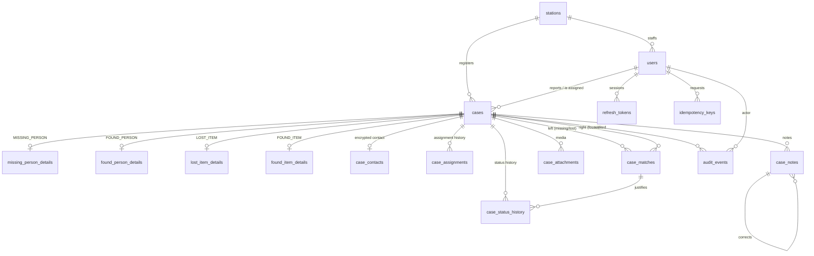
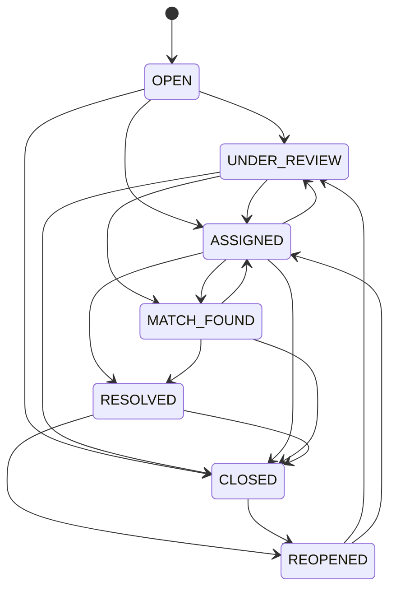

# Kumbh Setu — Lost & Found Backend

Case management API for police stations and help desks at Haridwar Kumbh Mela 2027. It handles missing persons, found persons, lost items, and found items. It records who did what and when, and keeps contact details and media private.

Stack: Python 3.12, FastAPI, PostgreSQL 16, SQLAlchemy 2, Alembic, Pydantic 2, Argon2id + JWT, S3-compatible private object storage, Pytest, Docker Compose.

```
backend/
  app/
    api/            HTTP layer: middleware, error handlers, health, v1 routers
    auth/           passwords, tokens, permission matrix, row-level scope, auth service
    audit/          audit writer and redaction
    common/         errors, request context, encryption, time helpers
    config/         typed settings (environment variables)
    database/       engine, session, naming conventions
    models/         SQLAlchemy models
    repositories/   case queries (search, scope filters, numbering)
    schemas/        Pydantic request/response models
    services/       business rules (cases, workflow, admin, attachments, idempotency)
    storage/        S3 client, file signature validation, optional ClamAV scanner
    cli.py          create-admin, ensure-bucket, purge-expired
  alembic/          migrations
  tests/            pytest suite (runs against real PostgreSQL)
docker/             Postgres init script, object store entrypoint
docker-compose.yml
.env.example
```

## Architecture

- **Layering.** Routers parse requests and call services. Services enforce permissions, scope, state transitions, and audit, and they own the transaction (one explicit `commit` per use case). The request session always rolls back on exit, so a failed request cannot leave partial writes.
- **Shared case supertype.** `cases` holds what every case has: number, type, status, urgency, station, reporter, assignee, timestamps, and the search document. Each type has a 1:1 detail table (`missing_person_details`, `found_person_details`, `lost_item_details`, `found_item_details`). The detail tables reference `cases(id, case_type)` through a composite foreign key and carry `CHECK (case_type = '…')`, so a lost item's details cannot attach to a missing-person case.
  - *Trade-off:* this costs one join per detail read. In exchange, assignments, notes, attachments, status history, audit, matches, and cross-type search all live in one place with real foreign keys, and adding a case type means adding a table, not reworking every workflow table.
- **Case numbers** look like `KSLF-LI-2027-000123` (MP/FP/LI/FI, year in Asia/Kolkata time). They come from `case_number_counters` via `INSERT … ON CONFLICT DO UPDATE … RETURNING`, an atomic row-locked increment that is safe under concurrency. `MAX(id)+1` is never used.
- **Enums** are stored as `VARCHAR` with `CHECK` constraints, so adding a value is a normal migration with no `ALTER TYPE`.
- **Search** uses a generated `tsvector` column (`'simple'` config, which suits names in mixed scripts and transliterations) over a service-maintained `search_text`, with a GIN index. It is combined with structured filters and stable `created_at DESC, id DESC` ordering.
- **Append-only records.** `audit_events`, `case_notes`, and `case_status_history` have triggers that reject `UPDATE`, `DELETE`, and `TRUNCATE`. The runtime database role also has those privileges revoked. Notes are corrected by adding a note that references the original.
- **Human-confirmed matching only.** Matches are proposals. Confirming a match requires police or admin, and the confirmer must be a different person from the proposer. Confirming moves both cases to `MATCH_FOUND` when that transition is valid from their current status. Nothing is marked reunited or returned automatically: `RESOLVED` is a separate status change that needs a confirmed match or written verification evidence.
- **Two database roles.** Migrations run as the schema owner (`kumbh_owner`). The API connects as `kumbh_app`, which has DML rights only, plus the append-only restrictions above.

## Tables and relationships



All foreign keys are `ON DELETE RESTRICT`. Cases, users, and stations are never hard-deleted; they are closed or deactivated so history stays intact.

| Child → parent | Cardinality | Foreign key | Nullable | Unique / constraint | Indexes |
|---|---|---|---|---|---|
| users → stations | many:1 | `station_id` | yes, admins only (`CHECK`) | `username` (lowercase `CHECK`), `email`, `police_badge_number` | `(station_id, role, is_active)` |
| cases → stations | many:1 | `station_id` | no | `case_number`; `(id, case_type)` | `(station_id, created_at)`, `(case_type, status, created_at)`, `(created_at, id)`, GIN `search_vector` |
| cases → users | many:1 ×2 | `reported_by_user_id`, `assigned_to_user_id` | reporter no, assignee yes | — | both columns |
| `*_details` → cases | 1:1 | `(case_id, case_type)` | no (PK) | `CHECK case_type = …` | date and category columns |
| case_contacts → cases | 1:0..1 | `case_id` | no (PK) | Fernet ciphertext only | — |
| case_assignments → cases, users | many:1 | `case_id`, `assigned_to_user_id`, `assigned_by_user_id` | no | partial unique: one active row per case | `(case_id, assigned_at)`, `(assigned_to_user_id) WHERE active` |
| case_notes → cases | many:1 | `case_id`, `author_user_id` | no | `(id, case_id)` | `(case_id, created_at)` |
| case_notes → case_notes | many:1 | `(corrects_note_id, case_id)` | yes | a correction must belong to the same case | — |
| case_attachments → cases | many:1 | `case_id`, `uploaded_by_user_id`, `deleted_by_user_id` | deleted_by yes | `storage_key` | `(case_id, created_at)` |
| case_status_history → cases | many:1 | `case_id`, `changed_by_user_id`, `match_id` | match yes | append-only | `(case_id, created_at)` |
| case_matches → cases | many:1 ×2 | `(left_case_id, left_case_type)`, `(right_case_id, right_case_type)` | no | unique pair; `CHECK` left ∈ {MP, LI}, right ∈ {FP, FI}, and kinds agree | `right_case_id` |
| audit_events → users, cases | many:1 | `actor_user_id`, `case_id` | yes (system events / non-case) | append-only | `(case_id, created_at)`, `(actor, created_at)`, `(action, created_at)` |
| refresh_tokens → users | many:1 | `user_id` | no | SHA-256 token hash | `(user_id) WHERE active` |
| idempotency_keys → users | many:1 | `user_id` | no | `(user_id, key)` | `expires_at` |
| login_attempts | — | — | — | — | `(username, created_at)` |

## Endpoints

Interactive docs live at `/docs` and the schema at `/openapi.json` (both disabled when `APP_ENV=production`). All `/api/v1` routes except login and refresh need `Authorization: Bearer <access token>`.

| Area | Routes |
|---|---|
| Health | `GET /health` (liveness), `GET /ready` (database + object storage) |
| Auth | `POST /api/v1/auth/login`, `/refresh`, `/logout`, `/change-password`; `GET /api/v1/auth/me` |
| Stations | `GET /stations`; `POST /stations`, `PATCH /stations/{id}` (admin) |
| Account recovery | `POST /auth/forgot-password`, `POST /auth/reset-password` (emailed or texted one-time code) |
| Users | `GET /users/assignable-officers`; `GET/POST /users`, `GET/PATCH /users/{id}`, `POST /users/{id}/reset-password` (admin) |
| Per-type cases | for `missing-persons`, `found-persons`, `lost-items`, `found-items`: `POST` and `GET /cases/{type}`; `GET` and `PATCH /cases/{type}/{id}`; `POST /cases/{type}/{id}/assign`; `POST /cases/{type}/{id}/status` |
| Custody | `POST /cases/found-items/{id}/custody` |
| Any case | `GET /cases` (cross-type search), `GET /cases/{id}`, `GET /cases/{id}/history` |
| Contacts | `POST /cases/{id}/contact/reveal` (police/admin, requires a reason, audited) |
| Notes | `GET/POST /cases/{id}/notes` |
| Attachments | `GET/POST /cases/{id}/attachments`; `GET /cases/{id}/attachments/{aid}` (presigned URL, audited); `DELETE …/{aid}` (soft delete) |
| Matches | `GET/POST /cases/{id}/matches`; `POST /cases/{id}/matches/{mid}/review` |
| Audit | `GET /audit-events` (admin) |

Conventions:
- **Pagination:** `limit` (1–100, default 25) and `offset`. Responses have the shape `{items, total, limit, offset}`.
- **Filters on list and search:** `q` (full text), `case_number`, `status` (repeatable), `urgency_level`, `station_id`, `assigned_to_user_id`, `unassigned`, `location`, `created_from`/`created_to`, `event_from`/`event_to` (last-seen or found time), `item_category`, `age_group`, `gender`, `language`, and `sort`. `GET /cases` also accepts `case_type` and `all_stations`.
- **Idempotent creation:** send `Idempotency-Key: <uuid>` on `POST /cases/{type}`. A retry with the same body returns the original case with `Idempotent-Replayed: true`. Reusing the key with a different body returns `409`.
- **Errors** always look like `{"error": {"code", "message", "request_id", "details"}}`. Validation details list the field location and message and never echo submitted values. A case outside your scope returns `404`, the same as a case that does not exist.
- **Every response** carries an `X-Request-ID` header (generated, or taken from a well-formed incoming header).

Example:

```bash
TOKEN=$(curl -s localhost:8000/api/v1/auth/login -H 'content-type: application/json' \
  -d '{"username":"admin","password":"…"}' | python -c 'import json,sys;print(json.load(sys.stdin)["access_token"])')
curl -s localhost:8000/api/v1/cases/missing-persons -H "Authorization: Bearer $TOKEN" \
  -H "Idempotency-Key: $(uuidgen)" -H 'content-type: application/json' \
  -d '{"approximate_age":7,"gender":"MALE","clothing_description":"red kurta","last_seen_location":"Har Ki Pauri","contact_details":"Father: +91 98765 43210"}'
```

## Authentication and permissions

- **Passwords** are hashed with Argon2id. The policy requires at least 12 characters with mixed character classes and rejects passwords that contain the username.
- **Lockout:** after `LOGIN_MAX_FAILURES` failures in `LOGIN_LOCKOUT_MINUTES`, the account is temporarily locked. Unknown usernames take the same time and return the same error.
- **Access token:** a JWT (HS256) valid for 15 minutes, carrying the user, session id, and token version.
- **Refresh token:** opaque `session_id.secret`, stored as a SHA-256 hash, valid for 7 days (`REFRESH_TOKEN_TTL_DAYS`), and rotated on every use. Reusing an old refresh token revokes the whole session.
- **Revocation:** every request re-checks that the user is active, the token version matches, and the session is live. Logout, password change, admin password reset, deactivation, and role or station changes all take effect immediately.

| Permission | Help desk | Police | Admin |
|---|:-:|:-:|:-:|
| Create/read/update cases, add notes, upload media, propose matches, move to UNDER_REVIEW | ✓ | ✓ | ✓ |
| Search all stations, assign, MATCH_FOUND/RESOLVED/CLOSED/REOPENED, custody, reveal contacts, sensitive notes, delete media, review matches | | ✓ | ✓ |
| Manage users and stations, read audit log | | | ✓ |

Row-level scope:
- **Admins** see every case.
- **Help-desk operators** see cases at their own station.
- **Police officers** see cases at their station, cases assigned to them, cases they reported, and cases linked by a non-rejected match to a case they can see. For matching across stations, police and admins can call `GET /cases?all_stations=true`. It returns summaries only (no contact data), each flagged with `in_scope`; full details still require scope.

Unauthorized roles are rejected before the request body is validated. Admin routes return `403` without revealing the request schema.

## Case lifecycle



Rules for status changes:
- Every change writes a `case_status_history` row (with a reason) and an audit event.
- `CLOSED` and `REOPENED` require a reason.
- `RESOLVED` requires a confirmed match on the case or `verification_evidence` text.
- Closed and resolved cases cannot be edited until they are reopened.
- A found item can be `RESOLVED` only after its custody is `RELEASED`.
- Custody moves `IN_CUSTODY` → `TRANSFERRED` (repeatable) → `RELEASED`. `RELEASED` is terminal and needs a recipient and verification text.

## Security protections

- **Secrets:** all secrets come from the environment. Production refuses to start with placeholder or short JWT secrets, a missing contact encryption key, or docs enabled. `.env` is gitignored, and `.env.example` contains placeholders only.
- **Contact data:** encrypted at rest with Fernet in `case_contacts`. Contacts never appear in list, search, or audit output; case detail returns only `has_contact_details`. Reading them requires the audited reveal endpoint.
- **Audit:** logins and failures, logouts, password events, user and station changes, case create/update, assignment, status, custody, notes, uploads, downloads, deletions, contact reveals, and match proposals and reviews. Values are redacted before storage, and each event records the request id, IP, and user agent.
- **Uploads:**
  - The type is detected from file signatures; the client's `Content-Type` and filename are ignored. A declared type that conflicts with the content is rejected.
  - Separate size limits apply to photos and audio, and empty files are rejected.
  - Each file gets a SHA-256 checksum.
  - Object keys are `cases/{case_id}/{attachment_id}`, so client filenames never reach storage paths; the display name is sanitized.
  - Server-side encryption is configurable.
  - Optional ClamAV scanning fails closed when configured.
  - If the database write fails after an upload, the stored object is deleted.
- **Downloads:** the bucket is private. The API issues presigned URLs (default 300 s) only after scope checks, and each issuance is audited.
- **HTTP:**
  - Strict CORS allow-list.
  - Security headers: CSP `default-src 'none'`, `nosniff`, `X-Frame-Options: DENY`, `Referrer-Policy: no-referrer`, `Permissions-Policy`, `Cache-Control: no-store` on the API, and HSTS in production.
  - Request bodies over the limit get `413` before they are read.
  - Per-client sliding-window rate limit returns `429`.
  - Login has its own lockout.
- **SQL:** queries go through the SQLAlchemy ORM and bound parameters only, and a statement timeout is set on every connection.
- **Database privileges:** the runtime role cannot alter the schema or rewrite append-only tables.

## Running locally

Requirements: Docker with Compose, and Python 3.12+ for running tests outside containers.

```bash
cp .env.example .env
# Fill in every change-me value. Generate secrets with:
python -c "import secrets;print(secrets.token_urlsafe(48))"                                   # JWT_SECRET, DB and S3 passwords
python -c "from cryptography.fernet import Fernet;print(Fernet.generate_key().decode())"     # CONTACT_ENCRYPTION_KEY

docker compose up -d postgres objectstore
docker compose --profile ops run --rm migrate          # runs alembic upgrade head as the schema owner
docker compose up -d --wait api                        # also runs storage-init to create the private bucket
KUMBH_ADMIN_PASSWORD='…' docker compose run --rm -e KUMBH_ADMIN_PASSWORD api \
  python -m app.cli create-admin --username admin --full-name "Control Room Admin"
open http://localhost:8000/docs
```

Locally the object store is SeaweedFS (S3 API on `:8333`, volume data encrypted). Any S3-compatible service works: set `S3_ENDPOINT_URL` (leave it empty for AWS S3), `S3_SERVER_SIDE_ENCRYPTION=AES256` or `aws:kms`, and `S3_PUBLIC_ENDPOINT_URL` only when browsers can reach the store directly (CDN or public hostname). With a custom `S3_ENDPOINT_URL` and no public host, photo and download links are served by the API itself at `/api/v1/media/{token}`, so officers never need access to the object store's port; set `API_PUBLIC_BASE_URL` to the API's public origin behind a reverse proxy (required in staging and production).

To run the API from source instead of the container:

```bash
cd backend
python3.12 -m venv .venv && .venv/bin/pip install -e '.[dev]'
.venv/bin/alembic upgrade head          # with DATABASE_URL pointing at the owner role
.venv/bin/uvicorn app.main:app --reload
```

## Tests

The tests run against a real PostgreSQL database whose name must end in `_test`; the suite refuses to run otherwise. The Postgres init script creates `kumbh_setu_test`. S3 is mocked with moto. Each run rebuilds the schema through Alembic (downgrade to base, then upgrade to head), which also exercises the migrations.

```bash
cd backend
.venv/bin/python -m pytest -q
```

Coverage areas: schema constraints and triggers, migrations, auth (login, lockout, rotation, reuse detection, revocation), RBAC and station scope, case CRUD and validation, idempotency, search and pagination, assignment history, the status machine, custody, notes and corrections, matches with separation of duties, contact reveal, uploads (signatures, sizes, spoofed types, scope, soft delete, rollback compensation), audit redaction, OpenAPI, headers, body limits, and rate limits.

## Migrations

```bash
cd backend
.venv/bin/alembic revision --autogenerate -m "describe change"   # then review the generated file by hand
.venv/bin/alembic upgrade head
.venv/bin/alembic downgrade -1                                   # roll back one revision
.venv/bin/alembic check                                          # fails if models and schema have drifted
```

- Migrations are an explicit deploy step (the `migrate` service) and never run automatically at API startup. Run them as the owner role with `KUMBH_APP_DB_ROLE` set so grants are applied.
- The initial migration grants the app role DML on existing tables. New tables in later migrations must grant `SELECT, INSERT, UPDATE, DELETE` to the app role explicitly, or the migration must set `ALTER DEFAULT PRIVILEGES`.
- Prefer expand-then-contract changes (add a nullable column, backfill, then enforce) so old and new API versions can run side by side during a rollout.
- Back up before every production migration (see below). `downgrade` is for development and staging; in production, roll forward with a corrective migration or restore from backup.

## Deployment

- Build the image from `backend/Dockerfile`. It is a multi-stage build on Python 3.12-slim and runs as a non-root user with read-only application files. Uvicorn runs with `--no-proxy-headers`. Client IPs are taken from `TRUSTED_PROXIES` inside the application; do not enable proxy headers on Uvicorn.
- Run behind a TLS-terminating reverse proxy or load balancer. Put only that proxy's CIDRs in `TRUSTED_PROXIES`.
- Set `APP_ENV=production`, real secrets from a secret manager, `CORS_ORIGINS` set to the police console origin, and `S3_SERVER_SIDE_ENCRYPTION`.
- Use managed PostgreSQL with TLS (`?sslmode=require` in `DATABASE_URL`), point-in-time recovery, and the separate owner and app roles described above.
- Run multiple API replicas for availability. Set `RATE_LIMIT_BACKEND=redis` outside local development so limits are shared. The memory backend is per process.
- Supervised workers are not part of `docker compose up`. Start them with `docker compose --profile workers up -d scan-worker notifications-worker maintenance-worker` after migrations. `WORKERS_REQUIRED=true` makes `/ready` fail until their heartbeats are fresh.
- Schedule `python -m app.cli purge-expired` daily. It removes expired idempotency keys, login attempts older than 90 days, and sessions older than 30 days.

## Backup and restore

Do not run backups or restores against the operational volumes until the commands below have been reviewed. `ops/backup-volumes.sh` archives the named Docker volumes read-only. `ops/restore-volume-copy.sh` refuses to write to `kumbh-setu_pgdata` or `kumbh-setu_objectdata`.

```bash
ops/backup-volumes.sh
ops/restore-volume-copy.sh .backups/<stamp>/pgdata.tar.gz kumbh-setu_pgdata_restore_<stamp>
```

Logical dumps, after PostgreSQL is already running:

```bash
docker compose exec -T postgres pg_dump -U kumbh_owner -d kumbh_setu -Fc > kumbh_setu_$(date +%F).dump
# Restore into an empty database, never with --clean against the only copy:
docker compose exec -T postgres pg_restore -U kumbh_owner -d kumbh_setu_restore --no-owner < kumbh_setu_YYYY-MM-DD.dump
```

In production, rely on managed point-in-time recovery plus daily logical dumps stored encrypted off-site. Test a restore regularly by restoring into staging and running `alembic current` and the smoke checks.

Media: enable bucket versioning and replication to a second region or site, or sync periodically (`aws s3 sync s3://kumbh-setu-media s3://kumbh-setu-media-backup`). Attachments reference objects by key, so restore the database and the bucket to the same point in time. An attachment row whose object is missing returns `404` on download.

## Monitoring and troubleshooting

- **Probes:** `/health` for liveness and `/ready` for readiness. Readiness returns `503` with per-dependency status if the database or object storage is unreachable.
- **Logging:** logs go to stdout. Use the `X-Request-ID` value from a client error to find the matching log lines and the audit event's `request_id`.
- **What to alert on:** 5xx rate, `/ready` failures, 429 spikes, login failure bursts (`LOGIN_FAILED` audit events), and database pool saturation.

| Symptom | Likely cause |
|---|---|
| `permission denied for table …` | A new table is missing grants for the app role, or the API is running as the wrong role. |
| `/ready` reports `object_storage: error` | Wrong S3 endpoint or credentials, or the bucket is missing (run `python -m app.cli ensure-bucket`). |
| Photo links point at `localhost:8333` or an internal host | An old build or an explicit `S3_PUBLIC_ENDPOINT_URL=http://localhost:8333`. Clear it; links then come from the API (`/api/v1/media/…`). Behind a proxy also set `API_PUBLIC_BASE_URL`. A real public store host also needs bucket CORS for the console origin. |
| `POST /auth/forgot-password` returns `503 password_reset_unavailable` | `EMAIL_PROVIDER` is `disabled` and no SMS provider is configured. Use `EMAIL_PROVIDER=smtp` (set `SMTP_*`), or `console` locally (the code is logged). |
| `Append-only table … cannot be modified` | Expected: notes, history, and audit records cannot be edited. Add a correction note instead. |
| Tests refuse to run | `TEST_DATABASE_URL` must point at a database whose name ends in `_test`. |

## Known limitations

- **Rate limiting** defaults to memory per process. Staging and production settings require Redis. Compose wires `REDIS_URL` into the API; set `RATE_LIMIT_BACKEND=redis` to use it.
- **Malware scanning** requires `SCAN_MODE=clamav` and a reachable ClamAV daemon. There is no ClamAV service in the default Compose file. `SCAN_MODE=disabled` is local-only and must not be treated as a clean scan.
- **Geospatial search** is implemented with PostGIS (`/cases/nearby`, `/cases/map`, and location administration). Hindi support in matching is dictionary normalisation, not semantic or machine translation.
- **Matching** is deterministic and explainable. It never confirms identity, reunification, or release by itself. There is no face recognition.
- **Notifications** have an outbox, English and Hindi templates, and `console` or `mock` providers. A real SMS or WhatsApp provider is not integrated.
- **No public self-service portal and no volunteer role.** The API does not include a frontend.
- **Confirming a match** can move an active case, including `OPEN`, to `MATCH_FOUND` after human review. That is separate from the generic status-transition table.
- **Retention periods** in settings are operational defaults, not legally approved retention periods.
- **MFA** can be enabled as TOTP step-up (`MFA_MODE=totp`). It is not phishing-resistant, and production MFA remains unapproved.
- **Local object store:** SeaweedFS is used in Compose. Production should use a managed private S3 bucket.
- **This workspace has no Git metadata.** CI configuration is in the tree but has not been executed by a hosted runner.
