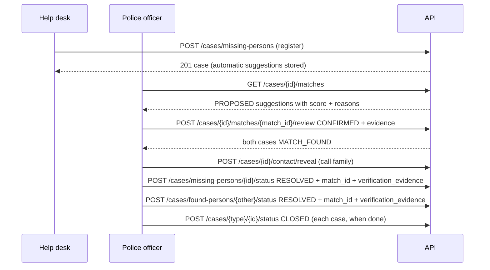

# API request and response reference

Exact contracts for every endpoint in [API_ENDPOINT_CATALOG.md](./API_ENDPOINT_CATALOG.md). Field definitions, enums, and nullability are in [DATABASE_AND_DATA_CONTRACTS.md](./DATABASE_AND_DATA_CONTRACTS.md). The machine-readable contract is [openapi.json](./openapi.json).

**All example values are sample data.** Names, ids, phone numbers, and tokens are fictitious. Every JSON example preceded by a `<!-- validate: … -->` marker is checked against the backend's own Pydantic model by `docs/api/tools/validate_examples.py` (see [API_TESTING_GUIDE.md](./API_TESTING_GUIDE.md)).

## 0. Common rules

### Base URL and versioning

All application endpoints are under `/api/v1`. Example local base: `http://localhost:8000/api/v1`.

### Headers

| Header | Direction | When | Notes |
|---|---|---|---|
| `Authorization: Bearer <access_token>` | request | Every `/api/v1` call except `auth/login` and `auth/refresh` | |
| `Content-Type: application/json` | request | JSON bodies | Uploads use `multipart/form-data`. |
| `Idempotency-Key: <8–128 chars>` | request | Optional on: case create, assign, status, custody, add note, match review, queue notification | Retrying with the same key and same body returns the original result with `Idempotent-Replayed: true`. Same key with a different body → `409 idempotency_key_reused`. Keys are per user and expire after 24 h (`IDEMPOTENCY_TTL_HOURS`). Not supported on PATCH, upload, propose match, or revoke. |
| `X-Request-ID: <8–64 chars [A-Za-z0-9._-]>` | request (optional) / response | Always returned | Echoed when valid, otherwise generated. Show it in error toasts for support. |
| `X-Step-Up-Code: <6 digits>` | request | Only when `MFA_MODE=totp`, for `POST /users/{id}/reset-password` and `POST /retention/runs/{id}/execute` | **Not** in the CORS allow-list (see gap G-17). |
| `Idempotent-Replayed: true` | response | On an idempotent replay | Exposed to browsers via CORS. |
| `Retry-After: <seconds>` | response | On `429` and `503` from the rate limiter | Exposed to browsers via CORS. |
| `WWW-Authenticate: Bearer` | response | On every `401` | |

Every API response also carries `Cache-Control: no-store`, `X-Content-Type-Options: nosniff`, `X-Frame-Options: DENY`, and a restrictive `Content-Security-Policy`.

### Pagination

Paginated endpoints use offset pagination with query parameters `limit` (default **25**, min 1, max **100**) and `offset` (default 0, max 100000), and return:

<!-- validate: app.schemas.common:Page[app.schemas.cases:CaseSummary] -->
```json
{
  "items": [],
  "total": 0,
  "limit": 25,
  "offset": 0
}
```

`total` is the number of rows matching the filters. Paginated: type-specific case lists, global search, notes, attachments, users, audit events. **Not** paginated (plain arrays): stations, locations, assignable officers, matches, notifications, nearby, legal holds, retention policies. Retention runs accept `limit`/`offset` but return a plain array without `total`.

### Error envelope

Every error, including validation, routing, rate-limit, and unhandled errors, uses one shape:

<!-- validate: app.schemas.common:ErrorResponse -->
```json
{
  "error": {
    "code": "case_not_found",
    "message": "Case not found",
    "request_id": "4f1c2a9be0d34b7c8a6e5d4c3b2a1f00",
    "details": null
  }
}
```

Request-validation errors (`422 validation_failed`) put a list in `details`. Submitted values are never echoed back:

<!-- validate: app.schemas.common:ErrorResponse -->
```json
{
  "error": {
    "code": "validation_failed",
    "message": "Request validation failed",
    "request_id": "4f1c2a9be0d34b7c8a6e5d4c3b2a1f01",
    "details": [
      {"loc": ["body", "item_category"], "msg": "Field required", "type": "missing"},
      {"loc": ["body", "colour"], "msg": "Extra inputs are not permitted", "type": "extra_forbidden"}
    ]
  }
}
```

Domain validation errors (also `422`) use a specific `code` and usually `details: null`. The full code list is in section 14.

### Visibility rule

A case id outside the caller's scope, or of a different type than the URL's `{type}`, returns `404 case_not_found`. Treat 404 on a case as "not available to you", not necessarily "deleted".

---

## 1. Health

### Endpoint: Liveness — `GET /health`

**Purpose:** process is up. **Auth:** none. **Response 200:**

```json
{"status": "ok"}
```

### Endpoint: Readiness — `GET /ready`

**Purpose:** dependency readiness for load balancers. **Auth:** none. **Response:** `200` when every required check is `"ok"`, otherwise `503` with the same body and `"status": "degraded"`. Checks present depend on configuration (`object_storage` when S3 is configured, `rate_limiter` when Redis is used, `worker_*` when `WORKERS_REQUIRED=true`).

```json
{
  "status": "ok",
  "checks": {"database": "ok", "schema": "ok", "object_storage": "ok"},
  "informational": {"malware_scanner": "disabled_development_mode"}
}
```

**Frontend notes:** not required by the UI. Never use `/ready` for login gating.

---

## 2. Authentication

### Endpoint: Register (PUBLIC) — `POST /api/v1/auth/register` *(new)*

**Purpose:** citizen self-registration without staff assistance. **Auth:** none. **Role assigned:** always `PUBLIC` (clients cannot choose or submit a role). **Rate limit:** `RATE_LIMIT_REGISTER_PER_MINUTE` per IP (fail-closed).

**Request body:**

| Field | Type | Required | Rules |
|---|---|---|---|
| `username` | string | yes | Digits only, 10–15 chars. Treated as a mobile number and stored as E.164 digits without `+` (e.g. `9876543210` → `919876543210`). |
| `password` | string | yes | Same strength rules as staff passwords (`PASSWORD_MIN_LENGTH`, mixed character classes). |
| `full_name` | string | yes | 2–200 chars. |

<!-- validate: app.schemas.auth:RegisterRequest -->
```json
{"username": "9876543210", "password": "SecurePassword123", "full_name": "Test User"}
```

**Success 201:** `TokenResponse` (same structure as login). **Errors:** `409 duplicate`, `422 validation_failed` / `weak_password` / `invalid_phone`, `429 too_many_requests`.

**`GET /auth/me` for PUBLIC:** `role = "PUBLIC"`, `permissions = []`. Allowed citizen case endpoints are enforced by a default-deny route allowlist plus `reported_by_user_id` ownership, not by staff permission strings.

**Status:** Newly added — tested.

### Endpoint: Forgot password — `POST /api/v1/auth/forgot-password` *(new)*

**Purpose:** start self-service password reset for PUBLIC accounts. **Auth:** none. **Rate limit:** `RATE_LIMIT_FORGOT_PASSWORD_PER_HOUR` per IP (fail-closed).

<!-- validate: app.schemas.auth:ForgotPasswordRequest -->
```json
{"username": "9876543210"}
```

**Success 200** (identical for existing PUBLIC, non-PUBLIC, and unknown accounts):

<!-- validate: app.schemas.auth:MessageResponse -->
```json
{"message": "If an account exists, password reset instructions will be sent."}
```

When a matching active PUBLIC user exists, a single-use opaque token is stored as a SHA-256 hash (`password_reset_tokens`) and SMS delivery is attempted through the configured notification provider (`NotificationTemplate.PASSWORD_RESET`). **Delivery dependency:** without MSG91/templates (or a local mock/console provider), the secure token workflow still exists but SMS is not operational. Tokens are never returned in the API response or audit log.

**Status:** Newly added — tested (token workflow); SMS delivery blocked until provider credentials/templates are configured.

### Endpoint: Reset password — `POST /api/v1/auth/reset-password` *(new)*

**Purpose:** complete self-service reset with the opaque token. **Auth:** none. **Rate limit:** `RATE_LIMIT_RESET_PASSWORD_PER_HOUR` per IP (fail-closed).

<!-- validate: app.schemas.auth:ResetPasswordRequest -->
```json
{"token": "opaque-reset-token-sample-value", "new_password": "NewSecurePassword123"}
```

**Success 204.** Updates the password with Argon2id, consumes the token (single-use), and revokes every session (`token_version` bump). **Errors:** `401 invalid_reset_token`, `422 weak_password`, `429`.

**Status:** Newly added — tested.

### Endpoint: Login — `POST /api/v1/auth/login`

**Purpose:** login screen for staff **and** PUBLIC citizens (mobile username + password). **Auth:** none. **Rate limit:** 30/min per client IP (fail-closed if the shared limiter is down → `503`). **Lockout:** 5 failed attempts for a username within 15 minutes → `429 account_temporarily_locked` (settings `LOGIN_MAX_FAILURES`, `LOGIN_LOCKOUT_MINUTES`).

**Request body** (`application/json`):

| Field | Type | Required | Rules |
|---|---|---|---|
| `username` | string | yes | 1–64 chars. Trimmed and lowercased by the server. |
| `password` | string | yes | 1–128 chars. |

<!-- validate: app.schemas.auth:LoginRequest -->
```json
{"username": "officer.hkp", "password": "SAMPLE-not-a-real-password"}
```

**Success 200** — `TokenResponse`:

<!-- validate: app.schemas.auth:TokenResponse -->
```json
{
  "access_token": "eyJhbGciOiJIUzI1NiIsInR5cCI6IkpXVCJ9.SAMPLE.SAMPLE",
  "refresh_token": "0b6f7a52-3d1e-4c8a-9f2b-6e5d4c3b2a10.SAMPLE-opaque-secret",
  "token_type": "bearer",
  "expires_in": 900
}
```

`expires_in` is the access-token lifetime in seconds (`ACCESS_TOKEN_TTL_MINUTES`, default 15). The refresh token is opaque; do not parse it. Refresh sessions last `REFRESH_TOKEN_TTL_DAYS` (default 7).

**Errors:**

| HTTP | `code` | Cause |
|---|---|---|
| 401 | `invalid_credentials` | Unknown user, wrong password, or deactivated account (indistinguishable by design). |
| 422 | `validation_failed` | Missing/empty fields or extra fields. |
| 429 | `account_temporarily_locked` | Too many recent failures for this username. |
| 429 | `too_many_requests` | IP rate limit. `details.policy = "login"`, `Retry-After` header. |

**Frontend notes:** show one generic "Invalid username or password" message for 401. For 429 show the lockout message and disable the button for `Retry-After` seconds when present. **Implementation status:** Implemented — tested (`app/api/v1/auth.py:login`, `app/auth/service.py:login`).

### Endpoint: Refresh — `POST /api/v1/auth/refresh`

**Purpose:** obtain a new access token. **Auth:** none (the refresh token is the credential). **Rate limit:** 60/min per IP, fail-closed.

<!-- validate: app.schemas.auth:RefreshRequest -->
```json
{"refresh_token": "0b6f7a52-3d1e-4c8a-9f2b-6e5d4c3b2a10.SAMPLE-opaque-secret"}
```

`refresh_token`: string, 10–256 chars. **Success 200:** `TokenResponse` with a **new** `refresh_token`. The previous refresh token becomes invalid immediately.

**Errors:** `401 invalid_refresh_token` (malformed, unknown, or stale token), `401 session_revoked` (logged out, expired, password changed, user deactivated, or role/station changed).

**Critical:** presenting the *immediately previous* refresh token again is treated as theft and **revokes the whole session**, including the pair just issued. Two browser tabs (or two concurrent requests) refreshing with the same token will log the user out. Use a single-flight refresh (see [FRONTEND_INTEGRATION_GUIDE.md](./FRONTEND_INTEGRATION_GUIDE.md) §2). **Status:** Implemented — tested.

### Endpoint: Logout — `POST /api/v1/auth/logout`

**Auth:** Bearer. **Body:** none. **Success:** `204 No Content`. The session is revoked; its access token stops working immediately. **Errors:** `401`. **Status:** Implemented — tested.

### Endpoint: Current user — `GET /api/v1/auth/me`

**Purpose:** app shell, role-based menus. **Auth:** Bearer, all roles.

**Success 200** — `MeResponse` (= `UserRead` + `permissions`):

<!-- validate: app.schemas.auth:MeResponse -->
```json
{
  "id": "9a1e4b7c-2d3f-4a5b-8c6d-7e8f9a0b1c2d",
  "full_name": "Sample Officer Rawat",
  "username": "officer.hkp",
  "email": null,
  "phone_number": null,
  "role": "POLICE_OFFICER",
  "police_badge_number": "UK-HDW-0001",
  "station_id": "3f6b2c1e-8a4d-4e2b-9c71-5d0a6e8f1b22",
  "is_active": true,
  "last_login_at": "2026-10-29T03:45:12.104512Z",
  "created_at": "2026-10-20T06:00:00Z",
  "updated_at": "2026-10-29T03:45:12.104512Z",
  "permissions": [
    "attachment:delete", "attachment:download", "attachment:upload",
    "case:assign", "case:contact_read", "case:create", "case:custody_update", "case:read",
    "case:resolve", "case:review", "case:search_all_stations", "case:update",
    "match:propose", "match:review", "note:create", "note:sensitive",
    "notification:send", "user:list_assignable"
  ]
}
```

`permissions` is sorted alphabetically. **Errors:** `401` (`unauthenticated`, `token_expired`, `invalid_token`, `session_revoked`). **Status:** Implemented — tested.

### Endpoint: Change own password — `POST /api/v1/auth/change-password`

**Auth:** Bearer, all roles. **Rate limit:** 10/hour per user, fail-closed.

<!-- validate: app.schemas.auth:ChangePasswordRequest -->
```json
{"current_password": "SAMPLE-old-password", "new_password": "Ganga#River2027!"}
```

**Password policy** (`app/auth/passwords.py`): at least `PASSWORD_MIN_LENGTH` (default 12) characters, at most 128, must not contain the username, must mix at least three of lowercase / uppercase / digits / symbols, must differ from the current password.

**Success:** `204`. **Every session of the user, including the current one, is revoked**: discard tokens and send the user to login. **Errors:** `422 invalid_current_password`, `422 weak_password` (message explains the rule), `429`. **Status:** Implemented — tested.

### Endpoints: MFA — `POST /api/v1/auth/mfa/enroll`, `POST /api/v1/auth/mfa/confirm`

Optional TOTP step-up. **Disabled by default:** both return `409 mfa_disabled` unless `MFA_MODE=totp`. Enroll returns `{"secret": "<base32>", "digits": 6, "period_seconds": 30}` once; confirm takes `{"code": "123456"}` (exactly 6 digits) and returns `204`. Errors: `409 mfa_already_enabled`, `409 mfa_enrollment_missing`, `422 mfa_code_invalid`. **Frontend:** hide MFA UI unless the product enables it (no API reports the mode; see gap G-18). **Status:** Implemented — tested.

---

## 3. Stations

### Endpoint: List stations — `GET /api/v1/stations`

**Auth:** Bearer, all roles. **Query:** `include_inactive` (bool, default `false`). **Success 200:** array of `StationRead`, ordered by name. Use to resolve `station_id` to a display name and to populate the admin "station" dropdown.

<!-- validate: list[app.schemas.admin:StationRead] -->
```json
[
  {
    "id": "3f6b2c1e-8a4d-4e2b-9c71-5d0a6e8f1b22",
    "name": "Har Ki Pauri Police Chowki",
    "code": "HKP-PS",
    "kind": "POLICE_STATION",
    "location_description": "Near the main ghat entrance",
    "is_active": true,
    "created_at": "2026-10-20T06:00:00Z",
    "updated_at": "2026-10-20T06:00:00Z"
  }
]
```

### Endpoint: Create station — `POST /api/v1/stations` (Admin)

<!-- validate: app.schemas.admin:StationCreate -->
```json
{"name": "Sector 4 Lost & Found Desk", "code": "S4-DESK", "kind": "HELP_DESK", "location_description": "Next to the Sector 4 medical camp"}
```

Rules: `name` 2–200; `code` 2–32 matching `^[A-Z0-9_-]+$` (uppercase only) and unique; `kind` `POLICE_STATION`|`HELP_DESK`; `location_description` ≤500. **Success 201:** `StationRead`. **Errors:** `403 permission_denied`, `409 duplicate` ("A station with this code already exists"), `422`.

### Endpoint: Update station — `PATCH /api/v1/stations/{station_id}` (Admin)

Body (all optional): `name`, `location_description`, `is_active`. `code` and `kind` cannot be changed (sending them → `422 extra_forbidden`). Deactivate instead of deleting. **Success 200:** `StationRead`. **Errors:** `404 station_not_found`, `409 duplicate`. **Status (all three):** Implemented — tested (`app/api/v1/admin.py`, `app/services/admin.py`).

---

## 4. Users

### Endpoint: Assignable officers — `GET /api/v1/users/assignable-officers`

**Purpose:** assign-case dialog. **Roles:** Police, Admin (help desk → `403 permission_denied`). **Query:** `station_id` (uuid, optional). Police are always limited to their own station; passing another `station_id` → `403 station_scope`. Admin without `station_id` gets every active officer.

<!-- validate: list[app.schemas.admin:OfficerSummary] -->
```json
[
  {
    "id": "9a1e4b7c-2d3f-4a5b-8c6d-7e8f9a0b1c2d",
    "full_name": "Sample Officer Rawat",
    "police_badge_number": "UK-HDW-0001",
    "station_id": "3f6b2c1e-8a4d-4e2b-9c71-5d0a6e8f1b22"
  }
]
```

### Endpoint: User directory — `GET /api/v1/users/directory`

**Purpose:** resolve reporter, assignee, and note-author ids to display names on case screens. **Roles:** all (`case:read`). **Query:** `ids` (repeatable uuid, 1–100). Unknown ids are omitted. Returns only `id`, `full_name`, `role`, `station_id` — never email, phone, badge, or username.

<!-- validate: list[app.schemas.admin:UserDirectoryEntry] -->
```json
[
  {
    "id": "9a1e4b7c-2d3f-4a5b-8c6d-7e8f9a0b1c2d",
    "full_name": "Sample Officer Rawat",
    "role": "POLICE_OFFICER",
    "station_id": "3f6b2c1e-8a4d-4e2b-9c71-5d0a6e8f1b22"
  }
]
```

Example: `GET /api/v1/users/directory?ids=9a1e4b7c-2d3f-4a5b-8c6d-7e8f9a0b1c2d&ids=aaaa1111-2222-3333-4444-555566667777`

**Status:** Implemented — tested.

### Endpoint: List users — `GET /api/v1/users` (Admin)

**Query:** `limit`, `offset`, `role` (`Role`), `station_id` (uuid), `is_active` (bool). Ordered by `full_name`. **Success 200:** `Page[UserRead]`.

Example: `GET /api/v1/users?role=POLICE_OFFICER&station_id=3f6b2c1e-8a4d-4e2b-9c71-5d0a6e8f1b22&is_active=true&limit=50`

### Endpoint: Create user — `POST /api/v1/users` (Admin)

| Field | Type | Required | Rules |
|---|---|---|---|
| `full_name` | string | yes | 2–200 |
| `username` | string | yes | 3–64, `^[A-Za-z0-9._-]+$`, lowercased, unique |
| `email` | email | no | unique |
| `phone_number` | string | no | 6–32, `^\+?[0-9 ()-]+$` |
| `password` | string | yes | Password policy (see change-password). Share out of band. |
| `role` | `Role` | yes | |
| `police_badge_number` | string | conditional | Required for `POLICE_OFFICER`. 2–64, unique. |
| `station_id` | uuid | conditional | Required (active station) for `POLICE_OFFICER` and `HELP_DESK_OPERATOR`. Ignored as `null` for `ADMIN`. |

<!-- validate: app.schemas.admin:UserCreate -->
```json
{
  "full_name": "Sample Desk Operator Negi",
  "username": "desk.s4.negi",
  "email": "desk.s4.negi@example.org",
  "phone_number": "+91 90000 00000",
  "password": "Sangam#Desk2027!",
  "role": "HELP_DESK_OPERATOR",
  "station_id": "3f6b2c1e-8a4d-4e2b-9c71-5d0a6e8f1b22"
}
```

**Success 201:** `UserRead`:

<!-- validate: app.schemas.admin:UserRead -->
```json
{
  "id": "1b2c3d4e-5f60-4718-89ab-cdef01234567",
  "full_name": "Sample Desk Operator Negi",
  "username": "desk.s4.negi",
  "email": "desk.s4.negi@example.org",
  "phone_number": "+91 90000 00000",
  "role": "HELP_DESK_OPERATOR",
  "police_badge_number": null,
  "station_id": "3f6b2c1e-8a4d-4e2b-9c71-5d0a6e8f1b22",
  "is_active": true,
  "last_login_at": null,
  "created_at": "2026-10-29T05:10:00Z",
  "updated_at": "2026-10-29T05:10:00Z"
}
```

**Errors:** `409 duplicate` (message names the field: username, email, or badge), `422 station_required`, `422 invalid_station`, `422 badge_required`, `422 weak_password`.

### Endpoint: Get user — `GET /api/v1/users/{user_id}` (Admin)

**Success 200:** `UserRead`. **Errors:** `404 user_not_found`. **Status:** Implemented — **no test found**.

### Endpoint: Update user — `PATCH /api/v1/users/{user_id}` (Admin)

Body (all optional): `full_name`, `email`, `phone_number`, `role`, `police_badge_number`, `station_id`, `is_active`. `username` and `password` cannot be changed here. The resulting role/station/badge combination is re-validated. Changing `role` or `station_id`, or setting `is_active=false`, **revokes all the user's sessions**. An admin cannot deactivate or demote themselves (`403 self_lockout`). **Success 200:** `UserRead`.

### Endpoint: Reset password — `POST /api/v1/users/{user_id}/reset-password` (Admin)

<!-- validate: app.schemas.admin:PasswordResetRequest -->
```json
{"new_password": "Triveni#Reset2027!"}
```

**Success:** `204`; all of the user's sessions are revoked. **Errors:** `404`, `422 weak_password`, `429` (10/hour), and when `MFA_MODE=totp`: `403 mfa_enrollment_required` / `403 step_up_required` (send `X-Step-Up-Code`). **Status (users):** Implemented — tested except `GET /users/{user_id}`.

---

## 5. Locations (reference places)

### Endpoint: List locations — `GET /api/v1/locations`

**Roles:** all. **Query:** `kind` (`LocationKind`), `sector_id` (uuid), `q` (≤100 chars; case-insensitive substring of `name`, `name_local`, or `code`), `include_inactive` (bool, default false). Ordered by kind, name. **Max 1000 rows, no pagination.**

Shortcuts: `GET /api/v1/locations/sectors?q=` (active sectors) and `GET /api/v1/locations/ghats?sector_id=&q=` (active ghats).

<!-- validate: list[app.schemas.geo:LocationRead] -->
```json
[
  {
    "id": "5c4b3a29-1807-4f6e-9d5c-4b3a29180716",
    "kind": "GHAT",
    "code": "HKP-GHAT",
    "name": "Har Ki Pauri",
    "name_local": "हर की पौड़ी",
    "sector_id": "0a1b2c3d-4e5f-4061-8728-394a5b6c7d8e",
    "station_id": "3f6b2c1e-8a4d-4e2b-9c71-5d0a6e8f1b22",
    "latitude": 29.9563,
    "longitude": 78.1712,
    "is_active": true,
    "created_at": "2026-10-20T06:00:00Z",
    "updated_at": "2026-10-20T06:00:00Z"
  }
]
```

### Endpoint: Get location — `GET /api/v1/locations/{location_id}`

Returns the location even when inactive. **Errors:** `404 location_not_found`.

### Endpoint: Create location — `POST /api/v1/locations` (Admin)

<!-- validate: app.schemas.geo:LocationCreate -->
```json
{
  "kind": "GHAT",
  "code": "HKP-GHAT",
  "name": "Har Ki Pauri",
  "name_local": "हर की पौड़ी",
  "sector_id": "0a1b2c3d-4e5f-4061-8728-394a5b6c7d8e",
  "station_id": "3f6b2c1e-8a4d-4e2b-9c71-5d0a6e8f1b22",
  "latitude": 29.9563,
  "longitude": 78.1712
}
```

Rules: `code` `^[A-Z0-9][A-Z0-9-]{1,31}$`, unique; `sector_id` must reference a `SECTOR` and is not allowed when `kind=SECTOR`; `latitude`/`longitude` required. Location coordinates are **not** limited to the operating area. **Errors:** `409 location_code_taken`, `422 invalid_sector`, `422 invalid_station`.

### Endpoint: Update location — `PATCH /api/v1/locations/{location_id}` (Admin)

Body (optional): `name`, `name_local`, `sector_id`, `station_id`, `latitude`+`longitude` (must be sent together), `is_active`. `kind` and `code` are immutable. **Status (locations):** Implemented — tested.

---

## 6. Cases — type-specific endpoints

The seven operations below exist for each `{type}` ∈ `missing-persons`, `found-persons`, `lost-items`, `found-items` (custody only for `found-items`). They share an envelope; the type-specific fields differ.

### 6.1 Shared request envelope (create and update)

| Field | Create | Update | Type | Rules |
|---|---|---|---|---|
| `urgency_level` | optional | optional | `UrgencyLevel` | |
| `station_id` | **Admin: required**. Others: omit, or send own station | not allowed | uuid | Help desk/police sending another station → `403 station_scope`. Must be active (`422 invalid_station`). |
| `contact_details` | optional | optional | string 3–1000 | Write-only, encrypted. On update, `null` deletes the stored contact. |
| `location_id` | optional | optional | uuid | Active location (`422 invalid_location`). |
| `latitude`, `longitude` | optional | optional | float | Send both or neither. Must be in the operating area (`422 coordinates_out_of_area`). On update, send `latitude: null` and `longitude: null` (and `coordinate_source: null`) to clear. |
| `coordinate_source` | required with coordinates | same | `CoordinateSource` | `DEVICE_GPS` for browser geolocation, `MAP_PIN` for a pin dropped on a map. |
| `coordinate_accuracy_m` | optional | optional | float 0–100000 | Requires coordinates. Pass `GeolocationPosition.coords.accuracy`. |
| `expected_version` | — | optional (recommended) | int ≥1 | Stale → `409 case_changed`. |

Unknown fields are rejected (`422 extra_forbidden`).

### 6.2 Type-specific fields

Full field tables (types, limits, nullability) are in [DATABASE_AND_DATA_CONTRACTS.md §3.4](./DATABASE_AND_DATA_CONTRACTS.md#34-case-details-11-with-cases-returned-under-details). Summary of **required on create**:

| Type | Required fields | Everything else |
|---|---|---|
| Missing person | none (an empty body `{}` registers a case) | optional |
| Found person | none | optional |
| Lost item | `item_category`, `item_name` | optional |
| Found item | `item_category`, `item_name` | optional; `custody_status`, `handover_acknowledgement`, `released_at` are read-only |

The backend imposes no mandatory person fields. If operations need minimum data (e.g. a last-seen time), the frontend must enforce it, and the product owner should confirm (open question Q-3).

### 6.3 Endpoint: Register a case — `POST /api/v1/cases/{type}`

**Purpose:** registration forms. **Auth:** Bearer, all roles (`case:create`). **Headers:** optional `Idempotency-Key` (strongly recommended: generate one per form submission so a retry after a network failure does not create a duplicate case). **Rate limit:** 60/min per user.

Missing person request:

<!-- validate: app.schemas.cases:MissingPersonCreate -->
```json
{
  "urgency_level": "HIGH",
  "person_name": "Sample Child Name",
  "approximate_age": 7,
  "age_group": "CHILD",
  "gender": "FEMALE",
  "height_description": "About 3.5 ft",
  "clothing_description": "Red frock with yellow flowers, white slippers",
  "identifying_marks": "Small mole on left cheek",
  "language": "Hindi, Garhwali",
  "last_seen_location": "Near the clock tower, Har Ki Pauri",
  "last_seen_at": "2026-10-29T07:40:00+05:30",
  "has_disability": false,
  "medical_needs": null,
  "additional_description": "Was holding a blue balloon",
  "contact_details": "Father: Sample Parent, +91 90000 00001, staying at Sector 3 camp",
  "location_id": "5c4b3a29-1807-4f6e-9d5c-4b3a29180716",
  "latitude": 29.9562,
  "longitude": 78.1711,
  "coordinate_source": "DEVICE_GPS",
  "coordinate_accuracy_m": 12.5
}
```

Found person request:

<!-- validate: app.schemas.cases:FoundPersonCreate -->
```json
{
  "urgency_level": "CRITICAL",
  "approximate_age": 75,
  "age_group": "ELDERLY",
  "estimated_gender": "MALE",
  "physical_description": "Thin build, white beard, walks with a stick",
  "clothing_description": "White dhoti, saffron shawl",
  "identifying_marks": "Tattoo of 'Om' on right forearm",
  "found_location": "Bus stand, Sector 2",
  "found_at": "2026-10-29T08:05:00+05:30",
  "communication_status": "LIMITED",
  "language": "Bhojpuri",
  "has_disability": true,
  "care_or_assistance_required": "Needs help walking; possibly diabetic",
  "current_care_location": "Sector 2 medical camp",
  "safeguarding_review_required": true
}
```

Lost item request:

<!-- validate: app.schemas.cases:LostItemCreate -->
```json
{
  "item_category": "bag",
  "item_name": "Black backpack",
  "item_description": "Contains clothes and a steel tiffin",
  "brand_or_color": "Wildcraft, black",
  "identifying_features": "Torn left strap tied with red thread",
  "last_seen_location": "Parking lot P3",
  "last_seen_at": "2026-10-28T18:30:00+05:30",
  "contact_details": "Owner: Sample Pilgrim, +91 90000 00002"
}
```

Found item request:

<!-- validate: app.schemas.cases:FoundItemCreate -->
```json
{
  "item_category": "bag",
  "item_name": "Black backpack",
  "item_description": "Clothes and a steel tiffin inside",
  "item_condition": "Left strap torn",
  "found_location": "Near Gate 2, parking lot P3",
  "found_at": "2026-10-28T21:10:00+05:30",
  "storage_location": "HKP police chowki locker 4"
}
```

**Success 201** — the full case (`MissingPersonCaseRead` shown):

<!-- validate: app.schemas.cases:MissingPersonCaseRead -->
```json
{
  "id": "7d0c6f0e-3b6a-4c55-9a8e-2f1b7d9c4a11",
  "case_number": "KSLF-MP-2026-000042",
  "case_type": "MISSING_PERSON",
  "status": "OPEN",
  "urgency_level": "HIGH",
  "station_id": "3f6b2c1e-8a4d-4e2b-9c71-5d0a6e8f1b22",
  "reported_by_user_id": "1b2c3d4e-5f60-4718-89ab-cdef01234567",
  "assigned_to_user_id": null,
  "has_contact_details": true,
  "version": 1,
  "location_id": "5c4b3a29-1807-4f6e-9d5c-4b3a29180716",
  "latitude": 29.9562,
  "longitude": 78.1711,
  "coordinate_source": "DEVICE_GPS",
  "coordinate_accuracy_m": 12.5,
  "in_scope": true,
  "verification_evidence": null,
  "created_at": "2026-10-29T02:15:03.512000Z",
  "updated_at": "2026-10-29T02:15:03.512000Z",
  "closed_at": null,
  "archived_at": null,
  "anonymized_at": null,
  "details": {
    "person_name": "Sample Child Name",
    "approximate_age": 7,
    "age_group": "CHILD",
    "gender": "FEMALE",
    "height_description": "About 3.5 ft",
    "clothing_description": "Red frock with yellow flowers, white slippers",
    "identifying_marks": "Small mole on left cheek",
    "language": "Hindi, Garhwali",
    "last_seen_location": "Near the clock tower, Har Ki Pauri",
    "last_seen_at": "2026-10-29T02:10:00Z",
    "has_disability": false,
    "medical_needs": null,
    "additional_description": "Was holding a blue balloon"
  }
}
```

Found item response `details` (other types follow the same envelope):

<!-- validate: app.schemas.cases:FoundItemDetailsRead -->
```json
{
  "item_category": "bag",
  "item_name": "Black backpack",
  "item_description": "Clothes and a steel tiffin inside",
  "item_condition": "Left strap torn",
  "found_location": "Near Gate 2, parking lot P3",
  "found_at": "2026-10-28T15:40:00Z",
  "storage_location": "HKP police chowki locker 4",
  "custody_status": "IN_CUSTODY",
  "handover_acknowledgement": null,
  "released_at": null
}
```

`contact_details` is never in the response; check `has_contact_details`.

**Errors:**

| HTTP | `code` | Cause |
|---|---|---|
| 403 | `permission_denied` | Missing `case:create` (not possible for current roles). |
| 403 | `station_scope` | Non-admin sent another station's `station_id`. |
| 409 | `idempotency_key_reused` | Same key, different body. |
| 422 | `validation_failed` | Schema errors (missing `item_name`, future `last_seen_at`, naive datetime, unknown field, lat without lng, coordinates without `coordinate_source`, …). |
| 422 | `station_required` | Admin omitted `station_id`. |
| 422 | `invalid_station` | Station unknown or inactive. |
| 422 | `invalid_location` | `location_id` unknown or inactive. |
| 422 | `coordinates_out_of_area` | Coordinates outside `GEO_OPERATING_AREA`; `details.operating_area` lists the box. Often swapped lat/lng. |
| 422 | `invalid_idempotency_key` | Key shorter than 8 or longer than 128. |
| 429 | `too_many_requests` | `details.policy = "case_create"`. |

**Side effects:** case number allocated, status `OPEN`, initial status-history row, audit `CASE_CREATED`, encrypted contact row, and **automatic match suggestions** computed synchronously after commit (best effort; a matching failure does not fail registration). Suggestions are visible immediately via `GET /cases/{id}/matches`.

**Photos:** registration and photo upload are two calls. Create the case, then `POST /cases/{id}/attachments` for each photo (§7.4).

**Duplicate submissions:** the only server-side protection is `Idempotency-Key`. There is no detection of two different operators registering the same person or item (gap G-12); automatic matching does not compare cases of the same type.

**Implementation status:** Implemented — tested (`app/api/v1/cases.py:build_case_type_router.create`, `app/services/cases.py:create_case`).

### 6.4 Endpoint: List cases of one type — `GET /api/v1/cases/{type}`

**Purpose:** type-specific list screens. Returns **full case records** (`Page[{Type}CaseRead]`), not summaries.

**Query parameters** (shared with global search, `app/api/v1/cases.py:case_filters`):

| Param | Type | Default | Meaning |
|---|---|---|---|
| `q` | string ≤200 | — | Full-text search (PostgreSQL `websearch_to_tsquery`, `simple` dictionary) over the type's descriptive fields, **or** case-number substring. Supports quoted phrases and `-exclude`. No stemming or transliteration. |
| `case_number` | string ≤32 | — | Case-insensitive substring of the case number. |
| `status` | `CaseStatus`, repeatable | all | `?status=OPEN&status=ASSIGNED`. |
| `urgency_level` | `UrgencyLevel` | — | Single value. |
| `station_id` | uuid | — | Filter within the caller's scope. |
| `assigned_to_user_id` | uuid | — | "My cases": pass the current user's id. |
| `unassigned` | bool | — | `true`: no assignee; `false`: has an assignee. |
| `location` | string ≤200 | — | Case-insensitive substring of the free-text last-seen/found location. Does **not** filter by `location_id`. |
| `created_from` / `created_to` | datetime | — | Registration time; from inclusive, to exclusive. |
| `event_from` / `event_to` | datetime | — | `last_seen_at` / `found_at`; from inclusive, to exclusive. |
| `item_category` | string ≤64 | — | Case-insensitive exact match (items). |
| `age_group` | `AgeGroup` | — | Persons. |
| `gender` | `Gender` | — | Missing `gender` / found `estimated_gender`. |
| `language` | string ≤100 | — | Case-insensitive substring (persons). |
| `include_archived` | bool | `false` | Include archived cases. Has no effect for help desk (they never see archived cases). |
| `sort` | enum | `-created_at` | `-created_at`, `created_at`, `-updated_at`, `updated_at`. No other sort fields. |
| `limit`, `offset` | int | 25, 0 | See pagination. |

Not available: filters by `location_id`, sector, `custody_status`, `reported_by_user_id`, `has_contact_details`; sorting by urgency or event time (gaps G-10, G-11).

Examples:

```text
GET /api/v1/cases/missing-persons?status=OPEN&status=UNDER_REVIEW&urgency_level=CRITICAL&sort=-created_at&limit=25&offset=0
GET /api/v1/cases/found-persons?age_group=CHILD&gender=FEMALE&event_from=2026-10-29T00:00:00%2B05:30
GET /api/v1/cases/lost-items?item_category=mobile&q=samsung&unassigned=true
GET /api/v1/cases/found-items?assigned_to_user_id=9a1e4b7c-2d3f-4a5b-8c6d-7e8f9a0b1c2d&status=ASSIGNED
```

URL-encode `+` in offsets as `%2B`.

**Success 200:** `Page` of the type's read model. **Errors:** `401`, `422` (bad enum, bad uuid, limit >100). **Status:** Implemented — tested.

### 6.5 Endpoint: Case details — `GET /api/v1/cases/{type}/{case_id}`

**Success 200:** `{Type}CaseRead` (as in §6.3), including:

| Field | Type | Meaning |
|---|---|---|
| `in_scope` | bool | `true` when the case belongs to the caller's operational station (admin: always true; PUBLIC: owned cases). `false` means cross-station read-only context where visible. |
| `verification_evidence` | string \| null | Latest `RESOLVED` status-history verification/handover comment. Returned only to roles with `note:sensitive` (police/admin); help desk and PUBLIC receive `null`. |

**Errors:** `404 case_not_found` (out of scope, wrong type, or unknown), `422` (malformed uuid). **Status:** Modified — tested.

### 6.6 Endpoint: Edit case — `PATCH /api/v1/cases/{type}/{case_id}`

**Roles:** all (`case:update`), within scope. **Semantics:** partial update. Only fields present in the body are changed; a field sent as `null` is **cleared**. Sending a value equal to the current value is a no-op. If nothing changes, the case is returned unchanged with the same `version`.

<!-- validate: app.schemas.cases:MissingPersonUpdate -->
```json
{
  "expected_version": 1,
  "clothing_description": "Red frock with yellow flowers, barefoot",
  "urgency_level": "CRITICAL"
}
```

Clearing coordinates:

<!-- validate: app.schemas.cases:LostItemUpdate -->
```json
{"expected_version": 3, "latitude": null, "longitude": null, "coordinate_source": null}
```

**Rules:**

- Cases in `RESOLVED` or `CLOSED` cannot be edited (`409 case_closed`); reopen first. `MATCH_FOUND` cases can be edited.
- `item_category` and `item_name` cannot be set to `null` (`422 required_field`).
- `station_id` is not accepted. `custody_status` cannot be patched on found items (use custody endpoint).
- `contact_details: null` deletes the stored contact; a string replaces it.
- Editing descriptive fields or position re-runs automatic matching and re-scores open automatic suggestions.

**Success 200:** updated `{Type}CaseRead` with incremented `version`. **Errors:** `404`, `409 case_changed` (`details: {case_id, expected_version, current_version}`), `409 case_closed`, `422 required_field`, `422 invalid_location`, `422 coordinates_out_of_area`, `422 coordinate_source_required`. **Side effects:** audit `CASE_UPDATED` (changed field names only, not values) and `CONTACT_UPDATED` when contact changed. **Status:** Implemented — tested.

### 6.7 Endpoint: Assign or reassign — `POST /api/v1/cases/{type}/{case_id}/assign`

**Roles:** Police, Admin (`case:assign`). **Headers:** optional `Idempotency-Key`.

<!-- validate: app.schemas.workflow:AssignRequest -->
```json
{
  "assignee_user_id": "9a1e4b7c-2d3f-4a5b-8c6d-7e8f9a0b1c2d",
  "reason": "Officer on duty at Har Ki Pauri",
  "expected_version": 1
}
```

| Field | Required | Rules |
|---|---|---|
| `assignee_user_id` | yes | Active `POLICE_OFFICER`. Non-admins may only assign officers of their own station. |
| `reason` | no | 3–2000 chars. |
| `expected_version` | no | Stale → `409 case_changed`. |

**Success 200:** updated case. If the case was `OPEN`, `UNDER_REVIEW`, or `REOPENED` it becomes `ASSIGNED` (with a status-history row); otherwise the status is unchanged. The previous assignment row is closed (`unassigned_at` set).

**Errors:** `403 permission_denied` (help desk), `403 station_scope`, `404`, `409 case_changed`, `409 case_inactive` (case `RESOLVED`/`CLOSED`), `409 already_assigned`, `422 invalid_assignee`.

**Not supported:** unassigning, assigning to a team, assigning to help-desk users, supervisor approval, or notifying the assignee (gaps G-4, G-6). **Status:** Implemented — tested (`app/services/workflow.py:assign_case`).

### 6.8 Endpoint: Change status — `POST /api/v1/cases/{type}/{case_id}/status`

**Roles:** depends on target status (see [DATABASE_AND_DATA_CONTRACTS.md §6.1](./DATABASE_AND_DATA_CONTRACTS.md#61-case-status-post-casestypeidstatus)). **Headers:** optional `Idempotency-Key`.

| Field | Required | Rules |
|---|---|---|
| `status` | yes | Target `CaseStatus`. |
| `reason` | **yes** | 3–2000 chars. |
| `match_id` | conditional | Required for `MATCH_FOUND`; optional evidence for `RESOLVED`. Must be a `CONFIRMED` match on this case. |
| `verification_evidence` | conditional | 10–5000 chars. Required for `RESOLVED` without `match_id`, and always for safeguarding-flagged found persons. |
| `expected_version` | no | |

Close:

<!-- validate: app.schemas.workflow:StatusChangeRequest -->
```json
{"status": "CLOSED", "reason": "Duplicate registration of KSLF-MP-2026-000041", "expected_version": 2}
```

Resolve after a confirmed match (reunification):

<!-- validate: app.schemas.workflow:StatusChangeRequest -->
```json
{
  "status": "RESOLVED",
  "reason": "Child handed over to father at HKP chowki",
  "match_id": "8b7a6c5d-4e3f-4a2b-9c1d-0e9f8a7b6c5d",
  "verification_evidence": "Father showed Aadhaar; child recognised him; photo on file matched. Witness: Const. Sample.",
  "expected_version": 4
}
```

Resolve a found item after release (ownership verified without a match record):

<!-- validate: app.schemas.workflow:StatusChangeRequest -->
```json
{
  "status": "RESOLVED",
  "reason": "Returned to owner",
  "verification_evidence": "Owner described tiffin contents and the red thread on the strap before seeing the bag."
}
```

**Success 200:** updated case.

**Errors:**

| HTTP | `code` | Cause / `details` |
|---|---|---|
| 403 | `permission_denied` | Role lacks the permission for this target (help desk can only move to `UNDER_REVIEW`). |
| 409 | `invalid_status_transition` | Not allowed from current status. `details: {"from": "OPEN", "to": "RESOLVED", "allowed": ["ASSIGNED", "CLOSED", "UNDER_REVIEW"]}`. Also for `status: "OPEN"`. |
| 409 | `case_changed` | Stale `expected_version`. |
| 409 | `assignee_required` | Target `ASSIGNED` without an assignee; use the assign endpoint. |
| 409 | `custody_not_released` | Resolving a found item that is not `RELEASED`. |
| 409 | `case_anonymized` | Reopening an anonymised case. |
| 422 | `match_required` | `MATCH_FOUND` without `match_id`. |
| 422 | `invalid_match` | `match_id` not on this case. |
| 422 | `match_not_confirmed` | Match not `CONFIRMED`. |
| 422 | `safeguarding_evidence_required` | Flagged found person without `verification_evidence` (checked first). |
| 422 | `verification_required` | `RESOLVED` with neither `match_id` nor `verification_evidence`. |

**Frontend notes:** compute allowed actions from the transition table and the user's permissions; still handle `409 invalid_status_transition` and refresh the case, because another user may have changed it. **Status:** Implemented — tested (`app/services/workflow.py:change_status`).

### 6.9 Endpoint: Change custody (found items only) — `POST /api/v1/cases/found-items/{case_id}/custody`

**Roles:** Police, Admin (`case:custody_update`). **Headers:** optional `Idempotency-Key`. There is no `expected_version` on this endpoint.

| Field | Required | Rules |
|---|---|---|
| `custody_status` | yes | Target `CustodyStatus`. |
| `reason` | yes | 3–2000. |
| `storage_location` | conditional | 1–500. Required when target is `TRANSFERRED`; optional otherwise (updates the stored location when sent). |
| `recipient_acknowledgement` | conditional | 10–500. Required when target is `RELEASED`. Record who received the item; do not put phone numbers here. |

Transfer:

<!-- validate: app.schemas.workflow:CustodyChangeRequest -->
```json
{"custody_status": "TRANSFERRED", "reason": "Moved to central lost & found store", "storage_location": "Central L&F store, Rack B-12"}
```

Release (handover):

<!-- validate: app.schemas.workflow:CustodyChangeRequest -->
```json
{
  "custody_status": "RELEASED",
  "reason": "Handed over to verified owner",
  "recipient_acknowledgement": "Received by owner Sample Pilgrim (ID checked) in presence of HC Sample"
}
```

**Success 200:** `FoundItemCaseRead`; on release `details.handover_acknowledgement` and `details.released_at` are set. Case status is **not** changed; resolve separately.

**Errors:** `403`, `404`, `409 case_closed`, `409 invalid_custody_transition` (`details: {from, to, allowed}`; `RELEASED` is terminal), `422 storage_location_required`, `422 handover_required`.

**Custody history:** only the current state is on the case. Each change is in audit events (`CUSTODY_CHANGED`), which only admins can read (gap G-7). **Status:** Implemented — tested (`app/services/workflow.py:change_custody`).

---

## 7. Cases — shared operations

### 7.1 Endpoint: Global search — `GET /api/v1/cases`

**Purpose:** cross-type search bar, combined lists. **Query:** all filters from §6.4, plus `case_type` (`CaseType`, optional) and `all_stations` (bool, Police/Admin; help desk → `403`). Default status filter: **all statuses**. Archived cases are excluded unless `include_archived=true`.

**Success 200:** `Page[CaseSummary]`. Summaries carry no contact details, notes, or full descriptions.

<!-- validate: app.schemas.common:Page[app.schemas.cases:CaseSummary] -->
```json
{
  "items": [
    {
      "id": "7d0c6f0e-3b6a-4c55-9a8e-2f1b7d9c4a11",
      "case_number": "KSLF-MP-2026-000042",
      "case_type": "MISSING_PERSON",
      "status": "ASSIGNED",
      "urgency_level": "HIGH",
      "station_id": "3f6b2c1e-8a4d-4e2b-9c71-5d0a6e8f1b22",
      "reported_by_user_id": "1b2c3d4e-5f60-4718-89ab-cdef01234567",
      "assigned_to_user_id": "9a1e4b7c-2d3f-4a5b-8c6d-7e8f9a0b1c2d",
      "title": "Sample Child Name",
      "location": "Near the clock tower, Har Ki Pauri",
      "location_id": "a1b2c3d4-1111-2222-3333-444455556666",
      "approximate_age": 7,
      "age_group": "CHILD",
      "gender": "MALE",
      "event_at": "2026-10-29T02:10:00Z",
      "version": 2,
      "created_at": "2026-10-29T02:15:03.512000Z",
      "updated_at": "2026-10-29T02:20:00Z",
      "in_scope": true
    }
  ],
  "total": 1,
  "limit": 25,
  "offset": 0
}
```

| Field | Meaning |
|---|---|
| `title` | Missing person: `person_name`; lost/found item: `item_name`; found person: always `null`. |
| `location` | Free-text last-seen/found location. |
| `location_id` | Reference location from registration (`GET /locations/{id}`). Redacted to `null` on out-of-scope match counterparts. |
| `approximate_age` | From person details; `null` for item cases. |
| `age_group` | From person details; `null` for item cases. |
| `gender` | Missing person: `gender`; found person: `estimated_gender`; item cases: `null`. Redacted on out-of-scope counterparts. |
| `event_at` | `last_seen_at` / `found_at`. |
| `reported_by_user_id` | Reporter user id. For PUBLIC citizens this is their own account; list results are ownership-filtered. |
| `in_scope` | `false` only with `all_stations=true` for cases the caller cannot open. Show as read-only; `GET /cases/{id}` will 404. |

Example: `GET /api/v1/cases?q=%22red%20frock%22&case_type=FOUND_PERSON&all_stations=true&status=OPEN`

**Rate limit:** 180/min per user (`search`). **Status:** Implemented — tested.

### 7.2 Endpoint: Nearby — `GET /api/v1/cases/nearby`

**Query:** `lat` (required, −90..90), `lng` (required, −180..180), `radius_m` (int ≥10, default 1000, max `GEO_MAX_RADIUS_M` = 10000 → else `422 radius_too_large`), `case_type`, `status` (repeatable; **default active only**: `OPEN`, `UNDER_REVIEW`, `ASSIGNED`, `MATCH_FOUND`, `REOPENED`), `all_stations`, `limit` (1–200, default 50).

Uses the case's own coordinates when recorded, otherwise its `location_id`'s coordinates. Cases with neither are never returned.

**Success 200:** `NearbyCase[]`, nearest first:

<!-- validate: list[app.schemas.geo:NearbyCase] -->
```json
[
  {
    "id": "2e9f8a7b-6c5d-4e3f-8a1b-0c9d8e7f6a5b",
    "case_number": "KSLF-FP-2026-000017",
    "case_type": "FOUND_PERSON",
    "status": "OPEN",
    "urgency_level": "CRITICAL",
    "station_id": "3f6b2c1e-8a4d-4e2b-9c71-5d0a6e8f1b22",
    "reported_by_user_id": "1b2c3d4e-5f60-4718-89ab-cdef01234567",
    "assigned_to_user_id": null,
    "title": null,
    "location": "Bus stand, Sector 2",
    "location_id": null,
    "event_at": "2026-10-29T02:35:00Z",
    "version": 1,
    "created_at": "2026-10-29T02:40:00Z",
    "updated_at": "2026-10-29T02:40:00Z",
    "in_scope": true,
    "distance_m": 412.7,
    "position": {"latitude": 29.9581, "longitude": 78.1748, "position_source": "case"}
  }
]
```

`position_source`: `case` (own GPS/map pin) or `location` (referenced place). **Status:** Implemented — tested.

### 7.3 Endpoint: Map markers — `GET /api/v1/cases/map`

**Query:** `min_lat`, `min_lng`, `max_lat`, `max_lng` (all required), `case_type`, `status` (repeatable, default active), `all_stations`. The box must have min < max (`422 invalid_bbox`) and span ≤ `GEO_MAX_BBOX_DEGREES` (0.5°) in each axis (`422 bbox_too_large`, ask the user to zoom in). At most `GEO_MAP_LIMIT` (500) markers, newest first.

<!-- validate: app.schemas.geo:CaseMap -->
```json
{
  "items": [
    {
      "id": "7d0c6f0e-3b6a-4c55-9a8e-2f1b7d9c4a11",
      "case_number": "KSLF-MP-2026-000042",
      "case_type": "MISSING_PERSON",
      "status": "ASSIGNED",
      "urgency_level": "HIGH",
      "station_id": "3f6b2c1e-8a4d-4e2b-9c71-5d0a6e8f1b22",
      "position": {"latitude": 29.9562, "longitude": 78.1711, "position_source": "case"},
      "in_scope": true
    }
  ],
  "truncated": false
}
```

Markers carry no names or descriptions; open details with `GET /cases/{id}`. **Status:** Implemented — tested.

### 7.4 Attachments

#### Endpoint: Upload — `POST /api/v1/cases/{case_id}/attachments`

**Roles:** all (`attachment:upload`). **Content type:** `multipart/form-data`. **Rate limit:** 30/min per user. No `Idempotency-Key` support.

| Form field | Type | Required | Rules |
|---|---|---|---|
| `media_type` | text | yes | `PHOTO` or `AUDIO`. |
| `file` | file | yes | One file per request. |

Accepted formats are detected from the file's bytes (the filename extension and declared MIME type are not trusted):

| `media_type` | Formats | Detected `content_type` | Max size |
|---|---|---|---|
| `PHOTO` | JPEG, PNG, WEBP | `image/jpeg`, `image/png`, `image/webp` | `MAX_PHOTO_BYTES` = 10 MB |
| `AUDIO` | WAV, MP3, M4A/MP4 audio, OGG, WEBM | `audio/wav`, `audio/mpeg`, `audio/mp4`, `audio/ogg`, `audio/webm` | `MAX_AUDIO_BYTES` = 25 MB |

HEIC/HEIF (default iPhone camera format), GIF, PDF, and video are **rejected** (`415`). Convert HEIC to JPEG client-side. The declared part `Content-Type` may be omitted or `application/octet-stream`; if sent, its family must match (`image/*` for photos, `audio/*`, `video/webm`, or `video/mp4` for audio).

```bash
curl -X POST "$BASE/cases/7d0c6f0e-3b6a-4c55-9a8e-2f1b7d9c4a11/attachments" \
  -H "Authorization: Bearer $TOKEN" \
  -F media_type=PHOTO \
  -F "file=@child.jpg;type=image/jpeg"
```

**Success:**

- `201 Created`: scanned (`CLEAN`, or `SKIPPED_DEV` in local development without a scanner).
- `202 Accepted`: stored in quarantine because the scanner was unavailable; it will be retried automatically. `downloadable: false` until clean.

<!-- validate: app.schemas.workflow:AttachmentRead -->
```json
{
  "id": "d4c3b2a1-9f8e-4d7c-a6b5-4c3b2a1f0e9d",
  "case_id": "7d0c6f0e-3b6a-4c55-9a8e-2f1b7d9c4a11",
  "uploaded_by_user_id": "1b2c3d4e-5f60-4718-89ab-cdef01234567",
  "media_type": "PHOTO",
  "original_filename": "child.jpg",
  "content_type": "image/jpeg",
  "file_size_bytes": 482113,
  "checksum_sha256": "9f86d081884c7d659a2feaa0c55ad015a3bf4f1b2b0b822cd15d6c15b0f00a08",
  "scan_status": "CLEAN",
  "scanned_at": "2026-10-29T02:16:10Z",
  "downloadable": true,
  "created_at": "2026-10-29T02:16:09Z"
}
```

**Errors:**

| HTTP | `code` | Cause |
|---|---|---|
| 404 | `case_not_found` | |
| 409 | `case_closed` | Case is `CLOSED`. |
| 413 | `payload_too_large` | Over the per-type limit (message states the MB limit) or over the 30 MB request limit. |
| 415 | `unsupported_media_type` | Unrecognised format. |
| 415 | `media_type_mismatch` | e.g. an image sent with `media_type=AUDIO`. |
| 415 | `content_type_mismatch` | Declared part type family contradicts the content. |
| 422 | `empty_file` | Zero bytes. |
| 422 | `malware_detected` | Infected; file deleted. `details.attachment_id`. |
| 422 | `validation_failed` | Missing `media_type` or `file`, or bad enum. |
| 503 | `storage_unavailable` | Object storage down; retry. |

**Status:** Implemented — tested (`app/services/attachments.py:upload_attachment`).

#### Endpoint: List attachments — `GET /api/v1/cases/{case_id}/attachments`

`Page[AttachmentRead]`, oldest first, excludes soft-deleted. Poll this (e.g. every 10 s, briefly) for items with `scan_status` `QUARANTINED`/`SCANNING`.

#### Endpoint: Get download URL — `GET /api/v1/cases/{case_id}/attachments/{attachment_id}`

Returns a short-lived presigned URL to the private bucket. Every call is audited (`ATTACHMENT_ACCESSED`).

<!-- validate: app.schemas.workflow:AttachmentDownload -->
```json
{
  "url": "https://storage.example.org/kumbh-setu-media/cases/7d0c6f0e-3b6a-4c55-9a8e-2f1b7d9c4a11/d4c3b2a19f8e4d7ca6b54c3b2a1f0e9d?X-Amz-Algorithm=AWS4-HMAC-SHA256&X-Amz-Expires=300&X-Amz-Signature=SAMPLE",
  "expires_in": 300,
  "content_type": "image/jpeg"
}
```

`expires_in` = `S3_PRESIGN_TTL_SECONDS` (default 300). The URL responds with `Content-Disposition: attachment`, which still renders in an `` but triggers a download when opened directly. There are no thumbnails or permanent URLs. **Errors:** `404 attachment_not_found`, `409 attachment_not_available` (`details.scan_status`), `503 storage_unavailable`.

#### Endpoint: Delete attachment — `DELETE /api/v1/cases/{case_id}/attachments/{attachment_id}`

**Roles:** Police, Admin. **A JSON body is required** (many HTTP clients drop DELETE bodies by default; see the integration guide):

<!-- validate: app.schemas.workflow:AttachmentDeleteRequest -->
```json
{"reason": "Wrong child photographed"}
```

**Success:** `204`. Soft delete; the object is purged later by retention. **Errors:** `403`, `404`, `422` (missing reason). **Status (attachments):** Implemented — tested.

### 7.5 Notes

#### Endpoint: List notes — `GET /api/v1/cases/{case_id}/notes`

`Page[NoteRead]`, **oldest first**. Sensitive notes are omitted (and not counted in `total`) for help-desk callers.

#### Endpoint: Add note — `POST /api/v1/cases/{case_id}/notes`

**Headers:** optional `Idempotency-Key`.

<!-- validate: app.schemas.workflow:NoteCreate -->
```json
{"note_text": "Announcement made on PA system at 08:10.", "note_type": "FOLLOW_UP", "is_sensitive": false}
```

Correction:

<!-- validate: app.schemas.workflow:NoteCreate -->
```json
{"note_text": "Correction: announcement was at 08:20, not 08:10.", "note_type": "CORRECTION", "corrects_note_id": "c1d2e3f4-a5b6-4c7d-8e9f-0a1b2c3d4e5f"}
```

**Success 201:**

<!-- validate: app.schemas.workflow:NoteRead -->
```json
{
  "id": "c1d2e3f4-a5b6-4c7d-8e9f-0a1b2c3d4e5f",
  "case_id": "7d0c6f0e-3b6a-4c55-9a8e-2f1b7d9c4a11",
  "author_user_id": "1b2c3d4e-5f60-4718-89ab-cdef01234567",
  "note_text": "Announcement made on PA system at 08:10.",
  "note_type": "FOLLOW_UP",
  "is_sensitive": false,
  "corrects_note_id": null,
  "created_at": "2026-10-29T02:45:00Z"
}
```

**Errors:** `403 permission_denied` (help desk with `is_sensitive: true`), `404 note_not_found` (correction target missing/invisible), `422 blank_note`, `422 correction_target_required`, `422 unexpected_correction_target`. Notes can be added in any case status, including `CLOSED`. **Status:** Implemented — tested.

### 7.6 Endpoint: Case history — `GET /api/v1/cases/{case_id}/history`

Status transitions and assignment history, oldest first. `verification_evidence` is `null` for help-desk callers.

<!-- validate: app.schemas.workflow:CaseHistory -->
```json
{
  "status_history": [
    {
      "id": "11111111-2222-4333-8444-555555555551",
      "from_status": null,
      "to_status": "OPEN",
      "changed_by_user_id": "1b2c3d4e-5f60-4718-89ab-cdef01234567",
      "reason": "Case registered",
      "verification_evidence": null,
      "match_id": null,
      "created_at": "2026-10-29T02:15:03Z"
    },
    {
      "id": "11111111-2222-4333-8444-555555555552",
      "from_status": "OPEN",
      "to_status": "ASSIGNED",
      "changed_by_user_id": "9a1e4b7c-2d3f-4a5b-8c6d-7e8f9a0b1c2d",
      "reason": "Officer on duty at Har Ki Pauri",
      "verification_evidence": null,
      "match_id": null,
      "created_at": "2026-10-29T02:20:00Z"
    }
  ],
  "assignments": [
    {
      "id": "22222222-3333-4444-8555-666666666661",
      "assigned_to_user_id": "9a1e4b7c-2d3f-4a5b-8c6d-7e8f9a0b1c2d",
      "assigned_by_user_id": "9a1e4b7c-2d3f-4a5b-8c6d-7e8f9a0b1c2d",
      "assigned_at": "2026-10-29T02:20:00Z",
      "unassigned_at": null,
      "reason": "Officer on duty at Har Ki Pauri",
      "is_active": true
    }
  ]
}
```

Not included: edits, notes, custody changes, contact views, attachment events (only in admin audit events). **Status:** Implemented — tested.

### 7.7 Endpoint: Reveal contact — `POST /api/v1/cases/{case_id}/contact/reveal`

**Roles:** Police, Admin (`case:contact_read`). Help desk → `403 permission_denied`.

<!-- validate: app.schemas.workflow:ContactRevealRequest -->
```json
{"reason_code": "REUNIFICATION_REVIEW", "note": "Calling father to confirm description"}
```

`reason_code` is required (enum in data contracts §4). `note` (≤200) is accepted but **not stored**.

<!-- validate: app.schemas.workflow:ContactRead -->
```json
{"case_id": "7d0c6f0e-3b6a-4c55-9a8e-2f1b7d9c4a11", "contact_details": "Father: Sample Parent, +91 90000 00001, staying at Sector 3 camp"}
```

**Errors:** `403`, `404 case_not_found`, `404 contact_not_found`, `422`. **Side effect:** audit `CONTACT_VIEWED` with the reason code. **Frontend:** do not cache the revealed value; clear it when leaving the screen. **Status:** Implemented — tested.

---

## 8. Matching and reunification

### How matching works (as implemented)

Matching is **deterministic and rule-based** (`app/matching/engine.py`, engine version `rules-2026.10.1`), **not AI/ML**, and does not use photos. Missing persons are compared with found persons; lost items with found items. Features: gender, age/age group, language, clothing colours and garments, identifying marks, location distance, time gap, disability (persons); category, name, colours, description, location, time (items). Hard contradictions exclude a pair. Hindi colour/garment words are normalised by dictionary. Details: `docs/MATCHING.md`.

Suggestions are created automatically after case creation or edit (if `MATCHING_AUTO_ENABLED`), on demand via `generate`, and by the `rematch` CLI. They are stored as `PROPOSED` + `AUTOMATIC`; nothing is confirmed automatically and no status changes.

Reunification flow supported by the API:



Each case is resolved separately; resolving one does not resolve its counterpart. For items, the found item must be custody-`RELEASED` before it can be `RESOLVED`.

### Endpoint: List matches for a case — `GET /api/v1/cases/{case_id}/matches`

**Roles:** all. Sorted by score (highest first, manual matches without a score last). Includes every status. `counterpart` is the other case's summary.

<!-- validate: list[app.schemas.workflow:MatchRead] -->
```json
[
  {
    "id": "8b7a6c5d-4e3f-4a2b-9c1d-0e9f8a7b6c5d",
    "match_domain": "PERSON",
    "status": "PROPOSED",
    "source": "AUTOMATIC",
    "review_stage": "AWAITING_FIRST_APPROVAL",
    "score": 0.9424,
    "confidence_band": "HIGH",
    "reasons": [
      {"feature": "clothing_colours", "weight": 2.0, "similarity": 1.0, "contribution": 2.0, "detail": "shared colours: red, yellow"},
      {"feature": "location", "weight": 2.0, "similarity": 0.955, "contribution": 1.91, "detail": "512 m apart"},
      {"feature": "age", "weight": 2.0, "similarity": 0.8, "contribution": 1.6, "detail": "7 vs 8 years (tolerance ±2.5)"},
      {"feature": "time", "weight": 1.5, "similarity": 1.0, "contribution": 1.5, "detail": "found 1.2 h after last seen"},
      {"feature": "gender", "weight": 1.0, "similarity": 1.0, "contribution": 1.0, "detail": "both FEMALE"}
    ],
    "engine_version": "rules-2026.10.1",
    "left_case_id": "7d0c6f0e-3b6a-4c55-9a8e-2f1b7d9c4a11",
    "right_case_id": "2e9f8a7b-6c5d-4e3f-8a1b-0c9d8e7f6a5b",
    "left_case_version": 2,
    "right_case_version": 1,
    "counterpart": {
      "id": "2e9f8a7b-6c5d-4e3f-8a1b-0c9d8e7f6a5b",
      "case_number": "KSLF-FP-2026-000018",
      "case_type": "FOUND_PERSON",
      "status": "OPEN",
      "urgency_level": "HIGH",
      "station_id": "3f6b2c1e-8a4d-4e2b-9c71-5d0a6e8f1b22",
      "reported_by_user_id": "1b2c3d4e-5f60-4718-89ab-cdef01234567",
      "assigned_to_user_id": null,
      "title": null,
      "location": "Near Malviya Dweep bridge",
      "location_id": "a1b2c3d4-1111-2222-3333-444455556666",
      "approximate_age": 7,
      "age_group": "CHILD",
      "gender": "MALE",
      "event_at": "2026-10-29T03:22:00Z",
      "version": 1,
      "created_at": "2026-10-29T03:30:00Z",
      "updated_at": "2026-10-29T03:30:00Z",
      "in_scope": true
    },
    "proposed_by_user_id": null,
    "rationale": null,
    "reviewed_by_user_id": null,
    "reviewed_at": null,
    "review_evidence": null,
    "revoked_by_user_id": null,
    "revoked_at": null,
    "revocation_reason": null,
    "created_at": "2026-10-29T03:30:01Z"
  }
]
```

**Redaction rules:** if the caller cannot see the counterpart case and lacks `case:search_all_stations` (help desk), `score`, `confidence_band`, `reasons`, `rationale` are `null` and `counterpart.title/location/event_at/location_id/approximate_age/age_group/gender` are `null`. `review_evidence` and `revocation_reason` are `null` for help desk. **Frontend:** label scores as "ranking, not proof of identity". **Status:** Implemented — tested.

### Endpoint: Match review queue — `GET /api/v1/matches`

**Purpose:** cross-case review queue for police and help-desk operators (scoped). **Roles:** all (`case:read`). **Query:** `status` (default `PROPOSED`), `confidence_band`, `match_domain`, `source` (`MANUAL` / `AUTOMATIC` / `FACE`), `limit`, `offset`.

Returns only matches that touch at least one case visible to the caller — the same rule as dashboard `pending_match_reviews`. Each row carries `left_case` and `right_case` summaries (redacted like `counterpart` above) instead of a single counterpart, plus `review_stage`, optional `face_similarity` / attachment ids for face candidates. Confirm or reject via `POST /cases/{id}/matches/{mid}/review`. FACE candidates need two different officers; embeddings are never returned.

<!-- validate: app.schemas.common:Page[app.schemas.workflow:MatchQueueItem] -->
```json
{
  "items": [
    {
      "id": "8b7a6c5d-4e3f-4a2b-9c1d-0e9f8a7b6c5d",
      "match_domain": "PERSON",
      "status": "PROPOSED",
      "source": "MANUAL",
      "review_stage": "AWAITING_FIRST_APPROVAL",
      "score": null,
      "confidence_band": null,
      "reasons": null,
      "engine_version": null,
      "left_case_id": "7d0c6f0e-3b6a-4c55-9a8e-2f1b7d9c4a11",
      "right_case_id": "2e9f8a7b-6c5d-4e3f-8a1b-0c9d8e7f6a5b",
      "left_case_version": 1,
      "right_case_version": 1,
      "left_case": {
        "id": "7d0c6f0e-3b6a-4c55-9a8e-2f1b7d9c4a11",
        "case_number": "KSLF-MP-2026-000042",
        "case_type": "MISSING_PERSON",
        "status": "OPEN",
        "urgency_level": "CRITICAL",
        "station_id": "3f6b2c1e-8a4d-4e2b-9c71-5d0a6e8f1b22",
        "reported_by_user_id": "1b2c3d4e-5f60-4718-89ab-cdef01234567",
        "assigned_to_user_id": null,
        "title": "Sample Child Name",
        "location": "Har Ki Pauri ghat steps",
        "location_id": null,
        "approximate_age": 7,
        "age_group": "CHILD",
        "gender": "MALE",
        "event_at": null,
        "version": 1,
        "created_at": "2026-10-29T02:15:03.512000Z",
        "updated_at": "2026-10-29T02:15:03.512000Z",
        "in_scope": true
      },
      "right_case": {
        "id": "2e9f8a7b-6c5d-4e3f-8a1b-0c9d8e7f6a5b",
        "case_number": "KSLF-FP-2026-000018",
        "case_type": "FOUND_PERSON",
        "status": "OPEN",
        "urgency_level": null,
        "station_id": "3f6b2c1e-8a4d-4e2b-9c71-5d0a6e8f1b22",
        "reported_by_user_id": "1b2c3d4e-5f60-4718-89ab-cdef01234567",
        "assigned_to_user_id": null,
        "title": null,
        "location": "Brahmakund",
        "location_id": null,
        "approximate_age": 7,
        "age_group": "CHILD",
        "gender": "MALE",
        "event_at": null,
        "version": 1,
        "created_at": "2026-10-29T03:30:00Z",
        "updated_at": "2026-10-29T03:30:00Z",
        "in_scope": true
      },
      "proposed_by_user_id": "9a1e4b7c-2d3f-4a5b-8c6d-7e8f9a0b1c2d",
      "rationale": "Same clothing and age at nearby ghat",
      "reviewed_by_user_id": null,
      "reviewed_at": null,
      "review_evidence": null,
      "revoked_by_user_id": null,
      "revoked_at": null,
      "revocation_reason": null,
      "created_at": "2026-10-29T03:30:01Z"
    }
  ],
  "total": 1,
  "limit": 25,
  "offset": 0
}
```

**Status:** Implemented — tested.

### Endpoint: Match review detail — `GET /api/v1/matches/{match_id}`

**Purpose:** side-by-side review for an authorised officer. **Roles:** `case:read` with at least one side in station/assignment scope. **404** `match_not_found` otherwise.

<!-- validate: app.schemas.faces:MatchDetail -->
```json
{
  "id": "8b7a6c5d-4e3f-4a2b-9c1d-0e9f8a7b6c5d",
  "match_domain": "PERSON",
  "status": "PROPOSED",
  "source": "FACE",
  "review_stage": "AWAITING_FIRST_APPROVAL",
  "score": 0.8351,
  "confidence_band": "HIGH",
  "reasons": null,
  "engine_version": "opencv_sface_2021dec",
  "face_similarity": 0.8351,
  "face_similarity_threshold": 0.363,
  "face_model": "opencv_sface_2021dec",
  "left_case_id": "7d0c6f0e-3b6a-4c55-9a8e-2f1b7d9c4a11",
  "right_case_id": "2e9f8a7b-6c5d-4e3f-8a1b-0c9d8e7f6a5b",
  "left_case_version": 2,
  "right_case_version": 1,
  "left_attachment_id": "aaaaaaaa-bbbb-cccc-dddd-eeeeeeeeeeee",
  "right_attachment_id": "ffffffff-0000-1111-2222-333333333333",
  "left_case": {
    "id": "7d0c6f0e-3b6a-4c55-9a8e-2f1b7d9c4a11",
    "case_number": "KSLF-MP-2026-000042",
    "case_type": "MISSING_PERSON",
    "status": "OPEN",
    "urgency_level": "CRITICAL",
    "station_id": "3f6b2c1e-8a4d-4e2b-9c71-5d0a6e8f1b22",
    "reported_by_user_id": "1b2c3d4e-5f60-4718-89ab-cdef01234567",
    "assigned_to_user_id": null,
    "title": "Sample Child Name",
    "location": "Har Ki Pauri ghat steps",
    "location_id": null,
    "approximate_age": 7,
    "age_group": "CHILD",
    "gender": "MALE",
    "event_at": null,
    "version": 2,
    "created_at": "2026-10-29T02:15:03.512000Z",
    "updated_at": "2026-11-05T10:00:00Z",
    "in_scope": true
  },
  "right_case": {
    "id": "2e9f8a7b-6c5d-4e3f-8a1b-0c9d8e7f6a5b",
    "case_number": "KSLF-FP-2026-000018",
    "case_type": "FOUND_PERSON",
    "status": "OPEN",
    "urgency_level": "HIGH",
    "station_id": "3f6b2c1e-8a4d-4e2b-9c71-5d0a6e8f1b22",
    "reported_by_user_id": "1b2c3d4e-5f60-4718-89ab-cdef01234567",
    "assigned_to_user_id": null,
    "title": null,
    "location": "Near Malviya Dweep bridge",
    "location_id": null,
    "approximate_age": 7,
    "age_group": "CHILD",
    "gender": "MALE",
    "event_at": "2026-10-29T03:22:00Z",
    "version": 1,
    "created_at": "2026-10-29T03:30:00Z",
    "updated_at": "2026-10-29T03:30:00Z",
    "in_scope": true
  },
  "proposed_by_user_id": null,
  "rationale": null,
  "first_approved_by_user_id": null,
  "first_approved_at": null,
  "first_approval_evidence": null,
  "reviewed_by_user_id": null,
  "reviewed_at": null,
  "review_evidence": null,
  "revoked_by_user_id": null,
  "revoked_at": null,
  "revocation_reason": null,
  "created_at": "2026-11-05T10:00:00Z"
}
```

**Status:** Implemented — tested. Embeddings are never included.

### Endpoint: Candidate photograph URL — `GET /api/v1/matches/{match_id}/photos/{side}`

**Purpose:** short-lived presigned URL for the left or right candidate photograph. **Roles:** `match:review` with a case in scope. **Path:** `side` is `left` or `right`. Audited as `ATTACHMENT_ACCESSED` with `purpose: match_review`.

<!-- validate: app.schemas.faces:MatchPhotoUrl -->
```json
{"side": "left", "attachment_id": "aaaaaaaa-bbbb-cccc-dddd-eeeeeeeeeeee", "url": "https://…", "expires_in": 300, "content_type": "image/jpeg"}
```

**Status:** Implemented — tested.

### Endpoint: Match history — `GET /api/v1/matches/{match_id}/history`

**Purpose:** audit trail for suggestion, first approval, confirmation/rejection. **Roles:** `match:review`.

<!-- validate: list[app.schemas.faces:MatchHistoryEvent] -->
```json
[{"id": "11111111-2222-3333-4444-555555555555", "action": "MATCH_FIRST_APPROVAL", "actor_user_id": "9a1e4b7c-2d3f-4a5b-8c6d-7e8f9a0b1c2d", "after_state": {"decision": "CONFIRMED"}, "reason": null, "created_at": "2026-11-05T10:05:00Z"}]
```

**Status:** Implemented — tested.

### Endpoint: Staff notifications — `GET /api/v1/staff-notifications`

**Purpose:** in-app alerts for the authenticated officer (face candidates). **Roles:** `case:read`. **Query:** `status` (`UNREAD`/`READ`), `limit`, `offset`. No SMS/WhatsApp/email.

<!-- validate: app.schemas.common:Page[app.schemas.faces:StaffNotificationRead] -->
```json
{"items": [{"id": "aaaaaaaa-bbbb-cccc-dddd-eeeeeeeeeeee", "kind": "MATCH_CANDIDATE", "status": "UNREAD", "match_id": "8b7a6c5d-4e3f-4a2b-9c1d-0e9f8a7b6c5d", "link": "/matches/8b7a6c5d-4e3f-4a2b-9c1d-0e9f8a7b6c5d", "created_at": "2026-11-05T10:00:01Z", "read_at": null}], "total": 1, "limit": 25, "offset": 0}
```

Mark read: `POST /api/v1/staff-notifications/{id}/read` → `StaffNotificationRead`. **Status:** Implemented — tested.

### Endpoint: Run matching now — `POST /api/v1/cases/{case_id}/matches/generate`

**Roles:** all (`match:propose`). **Body:** none. Only for cases in `OPEN`, `UNDER_REVIEW`, `ASSIGNED`, `REOPENED` (`409 case_not_matchable` otherwise). Candidates: counterpart type, matchable status, registered within ±14 days, not already paired; up to 10 new suggestions with score ≥ 0.40. When face matching is enabled, person-case photos are also compared.

<!-- validate: app.schemas.workflow:MatchGenerateResult -->
```json
{"created": 0, "suggestions": []}
```

`created` counts **new** suggestions only; existing ones are listed via `GET …/matches`. **Status:** Implemented — tested.

### Endpoint: Propose a manual match — `POST /api/v1/cases/{case_id}/matches`

**Roles:** all (`match:propose`). Police/admins may target cases at any station; help desk only cases in their scope.

<!-- validate: app.schemas.workflow:MatchProposeRequest -->
```json
{"other_case_id": "2e9f8a7b-6c5d-4e3f-8a1b-0c9d8e7f6a5b", "rationale": "Same red frock and mole described by the family; found 500 m away."}
```

`rationale` 10–5000. **Success 201:** `MatchRead` (`source: MANUAL`, `score: null`). A manual proposal grants the other station's police visibility of both cases. **Errors:** `404 case_not_found` (other case invisible/unknown or same case), `409 case_closed`, `409 duplicate_match` (pair already exists in any status, including rejected), `422 incompatible_case_types`. No `Idempotency-Key`. **Status:** Implemented — tested.

### Endpoint: Confirm or reject — `POST /api/v1/cases/{case_id}/matches/{match_id}/review`

**Roles:** Police, Admin (`match:review`). Separation of duties: the user who **proposed a manual match cannot confirm it** (`403 separation_of_duties`); they may reject it. **Headers:** optional `Idempotency-Key`.

<!-- validate: app.schemas.workflow:MatchReviewRequest -->
```json
{
  "decision": "CONFIRMED",
  "evidence": "Video call with father; he identified the child by name and the mole on her cheek.",
  "left_case_version": 2,
  "right_case_version": 1
}
```

`decision`: `CONFIRMED` or `REJECTED`. `evidence` 10–5000, required for both. Send `left_case_version`/`right_case_version` from the match you displayed to get `409 case_changed` on stale data.

**Success 200:** `MatchRead`. On `CONFIRMED`, **both cases move to `MATCH_FOUND`** in one transaction; they are not resolved.

**Errors:** `403 permission_denied`, `403 separation_of_duties`, `404 match_not_found`, `409 match_already_reviewed`, `409 case_changed`, `409 case_not_confirmable` (a case is `MATCH_FOUND`, `RESOLVED`, or `CLOSED`; `details.blocked_cases`), `409 conflicting_confirmed_match` (a case already has another confirmed match). **Status:** Implemented — tested.

### Endpoint: Revoke a confirmed match — `POST /api/v1/cases/{case_id}/matches/{match_id}/revoke`

**Roles:** Police, Admin.

<!-- validate: app.schemas.workflow:MatchRevokeRequest -->
```json
{"reason": "Family met the child and said she is not their daughter."}
```

**Success 200:** `MatchRead` with `status: REVOKED`. Cases in `MATCH_FOUND` return to `ASSIGNED` (if assigned) or `UNDER_REVIEW`. **Errors:** `404`, `409 match_not_confirmed`, `409 case_inactive` (a case is `RESOLVED`/`CLOSED`; reopen it first). No idempotency key. **Status:** Implemented — tested.

---

## 9. Notifications (SMS/WhatsApp/email/push to families and owners)

The outbox queues bilingual lifecycle messages to a consenting, verified recipient. Channels: `SMS`, `WHATSAPP`, `EMAIL`, `PUSH`. Adapters exist for MSG91, SMTP, and Firebase FCM (optional `.[push]` extra). Staging/production should keep `NOTIFICATION_PROVIDER=disabled` (or `mock` in non-prod) until MSG91 DLT templates, SMTP credentials, and Firebase/APNs are approved. Automated tests use mock/disabled providers only — **live delivery is not verified**.

### Endpoint: Queue a message — `POST /api/v1/cases/{case_id}/notifications`

**Roles:** all (`notification:send`). **Headers:** optional `Idempotency-Key` (scoped to case + template).

<!-- validate: app.schemas.notifications:NotificationCreate -->
```json
{
  "template": "CASE_REGISTERED",
  "channel": "SMS",
  "locale": "hi",
  "recipient_phone": "9000000001",
  "consent_statement": "Father agreed verbally at Har Ki Pauri desk"
}
```

| Field | Required | Rules |
|---|---|---|
| `template` | yes | `CASE_REGISTERED` or `CASE_UPDATE_VISIT_DESK`. Text contains only the case number and station name. |
| `channel` | no | `SMS` (default) or `WHATSAPP`. |
| `locale` | no | `hi` (default) or `en`. |
| `recipient_phone` | yes | 8–20 chars; `+91` assumed without a country code; must normalise to E.164 (`422 invalid_phone`). |
| `consent_statement` | yes | 10–500; who agreed and how. |

**Success 202:**

<!-- validate: app.schemas.notifications:NotificationRead -->
```json
{
  "id": "e5f6a7b8-c9d0-4e1f-a2b3-c4d5e6f7a8b9",
  "case_id": "7d0c6f0e-3b6a-4c55-9a8e-2f1b7d9c4a11",
  "template": "CASE_REGISTERED",
  "channel": "SMS",
  "locale": "hi",
  "recipient_hint": "••••0001",
  "status": "PENDING",
  "attempts": 0,
  "next_attempt_at": "2026-10-29T02:50:00Z",
  "last_error": null,
  "provider": null,
  "sent_at": null,
  "requested_by_user_id": "1b2c3d4e-5f60-4718-89ab-cdef01234567",
  "consent_statement": "Father agreed verbally at Har Ki Pauri desk",
  "created_at": "2026-10-29T02:50:00Z"
}
```

**Errors:** `404`, `409 case_closed` (closed or anonymised), `422 invalid_phone`, `422 unsupported_locale`.

### Endpoint: List messages — `GET /api/v1/cases/{case_id}/notifications`

Plain array of `NotificationRead`, oldest first. **Status:** Implemented — tested; delivery blocked.

---

## 10. Dashboard

### Endpoint: Summary — `GET /api/v1/dashboard/summary` *(modified)*

**Roles:** staff with `case:read` (PUBLIC is denied). Counts only cases visible to the caller and **excludes archived** cases. "Active" = `OPEN`, `UNDER_REVIEW`, `ASSIGNED`, `MATCH_FOUND`, `REOPENED`.

**Optional query (Asia/Kolkata calendar dates):**

| Param | Type | Notes |
|---|---|---|
| `from` | date (`YYYY-MM-DD`) | Inclusive start. Must be sent with `to`. |
| `to` | date (`YYYY-MM-DD`) | Inclusive end (implemented as next-day exclusive upper bound). |

Without parameters, behaviour is unchanged: point-in-time active/status counts and `registered_today` = since Asia/Kolkata midnight. With both parameters, the same case-created window filters dashboard metrics. Reversed ranges → `422 invalid_range`.

Example: `GET /api/v1/dashboard/summary?from=2026-11-01&to=2026-11-10`

<!-- validate: app.schemas.dashboard:DashboardSummary -->
```json
{
  "generated_at": "2026-10-29T09:00:00Z",
  "active_by_type": {"MISSING_PERSON": 14, "FOUND_PERSON": 9, "LOST_ITEM": 31, "FOUND_ITEM": 22},
  "by_status": {"OPEN": 40, "UNDER_REVIEW": 6, "ASSIGNED": 25, "MATCH_FOUND": 5, "RESOLVED": 61, "CLOSED": 12},
  "active_total": 76,
  "urgent_active": 7,
  "unassigned_active": 44,
  "registered_today": 18,
  "pending_match_reviews": 9,
  "attachments_awaiting_scan": 0,
  "notifications_failed": 0
}
```

**Important:** keys with a zero count are **omitted** from `active_by_type` and `by_status` (e.g. no `REOPENED` key above). Default missing keys to 0. `active_by_type` only counts active statuses, so it gives open missing persons etc., not totals. `pending_match_reviews` counts `PROPOSED` matches touching any visible case. Field names are unchanged. **Status:** Modified — date filtering tested.

---

## 11. Reports

### Endpoint: Case CSV export — `GET /api/v1/reports/cases.csv`

**Roles:** all (scoped). **Query:** `created_from` and `created_to` (both required datetimes; `to` must be after `from` → `422 invalid_range`; span ≤ 31 days → `422 range_too_large`). Archived cases are excluded. At most 1000 rows, oldest first.

**Response 200:** `text/csv`, `Content-Disposition: attachment; filename="cases.csv"`, `X-Export-Rows: <n>`, `X-Export-Truncated: true|false`.

```text
case_number,case_type,status,station_id,urgency_level,created_at
KSLF-MP-2026-000042,MISSING_PERSON,ASSIGNED,3f6b2c1e-8a4d-4e2b-9c71-5d0a6e8f1b22,HIGH,2026-10-29T02:15:03.512000+00:00
```

Columns are fixed. No names, descriptions, contact details, or notes. Cells starting with `= + - @` are prefixed with `'` to prevent spreadsheet formula injection. The `X-Export-*` and `Content-Disposition` headers are **not exposed via CORS** (gap G-16), so a cross-origin browser client cannot read them. Audit `CASE_EXPORTED`. **Status:** Partial.

---

## 12. Audit events (Admin)

### Endpoint: `GET /api/v1/audit-events`

**Query:** `limit`, `offset`, `case_id`, `actor_user_id`, `action` (exact `AuditAction` value, ≤64), `created_from` (inclusive), `created_to` (exclusive). Newest first.

<!-- validate: app.schemas.common:Page[app.schemas.workflow:AuditEventRead] -->
```json
{
  "items": [
    {
      "id": "f0e1d2c3-b4a5-4968-8776-655443322110",
      "actor_user_id": "9a1e4b7c-2d3f-4a5b-8c6d-7e8f9a0b1c2d",
      "action": "CUSTODY_CHANGED",
      "entity_type": "case",
      "entity_id": "6f5e4d3c-2b1a-4098-8f7e-6d5c4b3a2918",
      "case_id": "6f5e4d3c-2b1a-4098-8f7e-6d5c4b3a2918",
      "case_number": "KSLF-FI-2026-000105",
      "before_state": {"custody_status": "IN_CUSTODY"},
      "after_state": {"custody_status": "RELEASED", "storage_location_changed": false},
      "reason": "Handed over to verified owner",
      "request_id": "4f1c2a9be0d34b7c8a6e5d4c3b2a1f02",
      "client_ip": "10.20.0.15",
      "created_at": "2026-10-29T06:30:00Z"
    }
  ],
  "total": 1,
  "limit": 25,
  "offset": 0
}
```

Example: `GET /api/v1/audit-events?case_id=6f5e4d3c-2b1a-4098-8f7e-6d5c4b3a2918&action=CUSTODY_CHANGED`

`before_state`/`after_state` shapes vary by action and are not a stable contract; render them as key/value pairs. **Status:** Implemented — tested.

---

## 13. Retention and legal holds (Admin)

### Endpoint: `GET /api/v1/retention/policies`

<!-- validate: list[app.schemas.retention:RetentionPolicyRead] -->
```json
[
  {"policy": "ARCHIVE_CLOSED_CASES", "data": "Closed and resolved cases", "after_days": 90, "action": "Hide from day-to-day lists and from help-desk staff. Reversible by reopening the case."},
  {"policy": "AUDIT", "data": "Audit events", "after_days": null, "action": "Never modified or deleted by the application (database-enforced)."}
]
```

(Actual response has five entries.)

### Endpoint: Plan a run — `POST /api/v1/retention/runs`

<!-- validate: app.schemas.retention:RetentionRunCreate -->
```json
{"policy": "ARCHIVE_CLOSED_CASES", "note": "Weekly archive"}
```

**Success 201:** `RetentionRunRead` with `status: PLANNED` and `plan_report`:

<!-- validate: app.schemas.retention:RetentionRunRead -->
```json
{
  "id": "aa00bb11-cc22-4d33-8e44-ff5566778899",
  "policy": "ARCHIVE_CLOSED_CASES",
  "status": "PLANNED",
  "parameters": {"after_days": 90},
  "plan_report": {"cutoff": "2026-07-31T09:00:00Z", "eligible": 2, "excluded_by_legal_hold": 0, "truncated": false, "sample_case_numbers": ["KSLF-LI-2026-000003", "KSLF-FI-2026-000004"]},
  "execution_report": null,
  "planned_by_user_id": "aa11bb22-cc33-4d44-8e55-ff6677889900",
  "approved_by_user_id": null,
  "approved_at": null,
  "executed_by_user_id": null,
  "execution_started_at": null,
  "executed_at": null,
  "cancelled_by_user_id": null,
  "cancelled_at": null,
  "note": "Weekly archive",
  "created_at": "2026-10-29T09:00:00Z"
}
```

### Endpoints: list, get, approve, cancel, execute

- `GET /api/v1/retention/runs?limit=25&offset=0` → `RetentionRunRead[]`, newest first.
- `GET /api/v1/retention/runs/{run_id}` → `404 retention_run_not_found`.
- `POST …/{run_id}/approve` (no body) → must be a **different** admin (`409 two_person_rule`); only `PLANNED` (`409 retention_run_state`).
- `POST …/{run_id}/cancel` body `{"reason": "Not needed this week"}` → only `PLANNED`/`APPROVED`.
- `POST …/{run_id}/execute` (no body) → only `APPROVED`. In staging/production, `ANONYMIZE_ARCHIVED_CASES` must be executed by the CLI task (`409 execute_via_retention_task`). Synchronous; may be slow for large runs. Step-up required when `MFA_MODE=totp`.

### Legal holds

- `GET /api/v1/cases/{case_id}/legal-holds` → `LegalHoldRead[]`.
- `POST /api/v1/cases/{case_id}/legal-holds` body:

<!-- validate: app.schemas.retention:LegalHoldCreate -->
```json
{"reason": "FIR registered; preserve all records", "reference": "FIR 123/2026 Haridwar Kotwali"}
```

- `POST /api/v1/cases/{case_id}/legal-holds/{hold_id}/release` body `{"reason": "Court disposed the matter"}` → `409 legal_hold_released` if already released.

**Status (retention):** Implemented — tested.

---

## 13b. Public citizen portal

### OTP — `POST /api/v1/public/otp/request` / `verify`

Request (report or sighting only; status uses the dedicated endpoints):

<!-- validate: app.schemas.public:OtpRequest -->
```json
{"mobile_number": "9876543210", "purpose": "REPORT_MISSING", "locale": "hi"}
```

Success always looks like an SMS was accepted (anti-enumeration for status uses the same shape). Verify returns `verified_mobile_token` for header `X-Verified-Mobile-Token`.

### Public missing person — `POST /api/v1/public/missing-persons`

`multipart/form-data` with `report` (JSON string of `PublicMissingPersonCreate`) and optional `photo`. Headers: `X-Verified-Mobile-Token`, `Idempotency-Key`. Success `201` (or `200` with `Idempotent-Replayed: true`):

```json
{"case_id": "MP-2026-000123", "status": "PENDING_VERIFICATION", "message": "…"}
```

### Status access — `POST /api/v1/public/status/request-otp` → `verify-otp` → `GET /api/v1/public/cases/{case_id}/status`

Request OTP always returns `OTP_SENT` whether or not the case/mobile pair exists. Verify issues a short-lived JWT with `scope: status:read`. GET returns only:

```json
{"case_id": "MP-2026-000123", "status": "UNDER_REVIEW", "updated_at": "2026-11-07T10:00:00Z", "message": "…"}
```

Never includes notes, contacts, staff, medical data, matches, or media.

### Sightings — `POST /api/v1/public/sightings`

Multipart `report` JSON (`PublicSightingCreate`) + optional `photo`. Requires verified-mobile token for `REPORT_SIGHTING`. Response acknowledges an `UNVERIFIED` sighting; case status is never changed. Staff list/detail/photo under `/api/v1/sightings`.

### Public information — `GET /api/v1/public/information`

Unauthenticated list of currently published bilingual items. Admin create/update/publish/unpublish under `/api/v1/admin/public-information` (`public_information:manage` only).

### Push tokens — `POST|DELETE /api/v1/devices/push-token`

Staff Bearer JWT, or citizen status JWT (optionally with `case_id` on register). Body includes `platform` + `token`. Success `204`.

### Public review — `POST /api/v1/cases/{case_id}/public-review`

```json
{"decision": "VERIFIED", "reason": "Documents checked at desk"}
```

Requires `case:review`. Approval may queue `CASE_APPROVED`; rejected/unverified reports are never represented as police-verified.

**Status (Phase 4 public):** Implemented — tested (mock providers). Live MSG91/SMTP/FCM delivery not verified.

---

## 14. Error code reference

Every `code` the backend can return, by HTTP status. Codes are stable identifiers; messages are English and may change. Map codes to UI copy (and Hindi translations) in the frontend.

| HTTP | Codes |
|---|---|
| 401 | `unauthenticated` (no/non-bearer header), `token_expired`, `invalid_token`, `session_revoked`, `invalid_credentials`, `invalid_refresh_token` |
| 403 | `permission_denied`, `station_scope`, `self_lockout`, `separation_of_duties`, `mfa_enrollment_required`, `step_up_required` |
| 404 | `not_found` (unknown route), `case_not_found`, `note_not_found`, `attachment_not_found`, `contact_not_found`, `match_not_found`, `station_not_found`, `user_not_found`, `location_not_found`, `legal_hold_not_found`, `retention_run_not_found` |
| 405 | `method_not_allowed` |
| 409 | `case_changed`, `case_closed`, `case_inactive`, `case_anonymized`, `already_assigned`, `assignee_required`, `invalid_status_transition`, `invalid_custody_transition`, `custody_not_released`, `duplicate_match`, `match_already_reviewed`, `match_not_confirmed` (revoke), `case_not_confirmable`, `conflicting_confirmed_match`, `case_not_matchable`, `attachment_not_available`, `idempotency_key_reused`, `idempotency_retry`, `duplicate`, `location_code_taken`, `mfa_disabled`, `mfa_already_enabled`, `mfa_enrollment_missing`, `two_person_rule`, `retention_run_state`, `legal_hold_released`, `execute_via_retention_task` |
| 413 | `payload_too_large` |
| 415 | `unsupported_media_type`, `media_type_mismatch`, `content_type_mismatch` |
| 422 | `validation_failed` (schema; `details` = list), `station_required`, `invalid_station`, `invalid_location`, `coordinates_out_of_area`, `coordinate_source_required`, `required_field`, `invalid_assignee`, `match_required`, `invalid_match`, `match_not_confirmed` (status change), `verification_required`, `safeguarding_evidence_required`, `storage_location_required`, `handover_required`, `blank_note`, `correction_target_required`, `unexpected_correction_target`, `incompatible_case_types`, `invalid_idempotency_key`, `empty_file`, `malware_detected`, `invalid_current_password`, `weak_password`, `badge_required`, `invalid_sector`, `radius_too_large`, `invalid_bbox`, `bbox_too_large`, `unsupported_locale`, `invalid_phone`, `invalid_range`, `range_too_large`, `mfa_code_invalid` |
| 429 | `too_many_requests` (`details.policy`: `login`, `refresh`, `password_change`, `upload`, `case_create`, `search`, `general`; `Retry-After`), `account_temporarily_locked` |
| 500 | `internal_error` |
| 503 | `rate_limiter_unavailable` (`Retry-After`), `storage_unavailable`, `service_unavailable` |

`match_not_confirmed` appears with two statuses: `422` when a status change references an unconfirmed match, `409` when revoking a match that is not confirmed.

### Rate limits (defaults, per minute unless noted)

| Policy | Applies to | Limit | Keyed by |
|---|---|---|---|
| `login` | `POST /auth/login` | 30 | client IP |
| `refresh` | `POST /auth/refresh` | 60 | client IP |
| `password_change` | change-password, reset-password | 10 per hour | user |
| `upload` | `POST /cases/{id}/attachments` | 30 | user |
| `case_create` | `POST /cases/{type}` | 60 | user |
| `search` | `GET /cases`, `/cases/{type}`, `/cases/nearby`, `/cases/map` | 180 | user |
| `general` | every `/api/v1` request (in addition) | 600 | user (IP if unauthenticated) |
| `public_otp` | `/public/otp/*`, `/public/status/*-otp` | `RATE_LIMIT_PUBLIC_OTP_PER_MINUTE` (default 10) | client IP (+ recipient hash in OTP service) |
| `public_submit` | `/public/missing-persons`, `/public/sightings` | `RATE_LIMIT_PUBLIC_SUBMIT_PER_MINUTE` (default 20) | client IP |
| `public_status` | `/public/cases/{id}/status` | `RATE_LIMIT_PUBLIC_STATUS_PER_MINUTE` (default 30) | client IP |

No `X-RateLimit-*` headers are sent; only `Retry-After` on 429.
