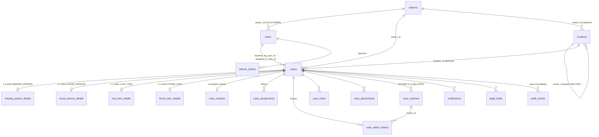
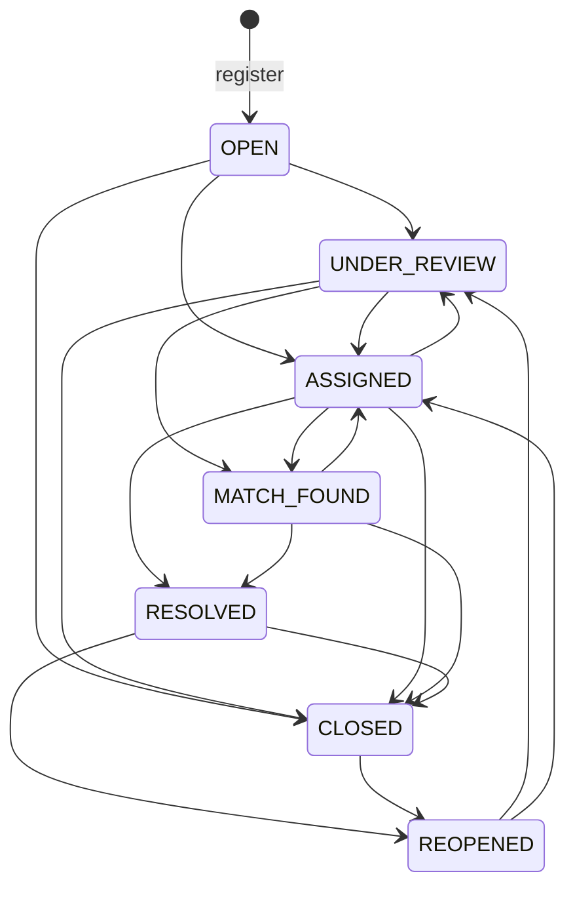
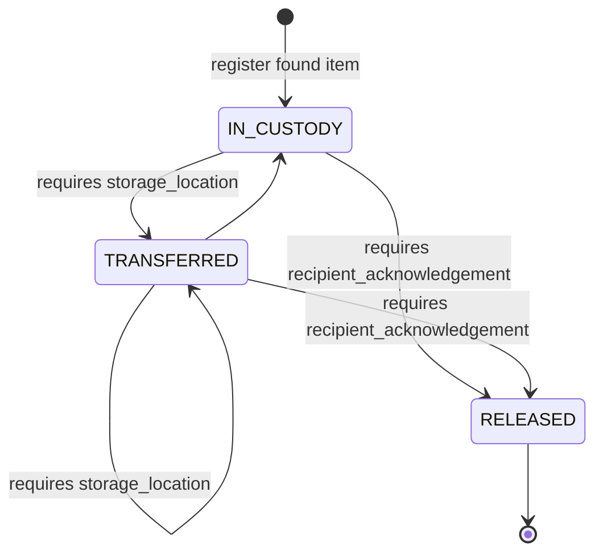

# Database and data contracts

Source of truth: `backend/app/models/*.py`, `backend/app/schemas/*.py`, and Alembic revisions `0001`–`0007` in `backend/alembic/versions/`. Everything in sections 1–6 exists in the schema. Section 7 lists entities the frontend may expect that **do not exist**.

## 1. Conventions

| Topic | Contract |
|---|---|
| Identifiers | Every primary key is a UUID (v4, generated by the API). Sent and returned as canonical lowercase strings, e.g. `"7d0c6f0e-3b6a-4c55-9a8e-2f1b7d9c4a11"`. |
| Case number | Human-facing id: `{CASE_NUMBER_PREFIX}-{type code}-{year}-{6-digit sequence}`. Default prefix `KSLF`. Type codes: `MP`, `FP`, `LI`, `FI`. Year is the registration year in `Asia/Kolkata`. Example: `KSLF-MP-2026-000042`. Allocated atomically per type and year (`case_number_counters`). Unique. |
| Timestamps (responses) | ISO 8601 with a UTC offset. Database columns are `timestamptz`. Parse with a standard ISO 8601 parser; do not assume a fixed string format or the absence of fractional seconds. |
| Timestamps (request bodies) | Event times (`last_seen_at`, `found_at`) **must include a timezone offset** (`2026-10-28T14:30:00+05:30`). Naive datetimes are rejected with `422`. Times more than 5 minutes in the future are rejected (`must not be in the future`). |
| Timestamps (query params) | `created_from`, `created_to`, `event_from`, `event_to` accept ISO 8601. Always send an offset; a naive value is interpreted by PostgreSQL in the session time zone. `*_from` is inclusive, `*_to` is exclusive. |
| "Today" | Dashboard `registered_today` counts since midnight `Asia/Kolkata`. |
| Enums | Stored as `VARCHAR(32)` with a CHECK constraint (not PostgreSQL enum types). Values are UPPER_SNAKE_CASE strings and are case-sensitive in requests. |
| Strings | All request models strip leading/trailing whitespace and **forbid unknown fields** (`422 validation_failed`, `type: extra_forbidden`). |
| Coordinates | WGS 84 decimal degrees. Case coordinates must fall inside `GEO_OPERATING_AREA` (default `[29.70, 77.90, 30.25, 78.45]` = min_lat, min_lng, max_lat, max_lng) or the API returns `422 coordinates_out_of_area`. |
| Optimistic concurrency | `cases.version` starts at 1 and increments on every write to the case row (edit, assign, status, custody). Send it back as `expected_version`; a mismatch returns `409 case_changed`. |
| Soft deletion | Nothing is hard-deleted through the API. Users, stations, and locations are deactivated (`is_active=false`). Attachments are soft-deleted (`deleted_at`). Cases are archived and later anonymised only by approved retention runs. |
| Append-only tables | `case_notes`, `case_status_history`, `audit_events` are append-only, enforced by database triggers. |

## 2. Entity relationship overview

All foreign keys use `ON DELETE RESTRICT`.

## 3. Entities

Column types below are the API types. "Nullable" means the API can return `null`.

### 3.1 `stations` — police stations and help desks

| Field | Type | Nullable | Notes |
|---|---|---|---|
| `id` | uuid | no | |
| `name` | string(2–200) | no | |
| `code` | string(2–32) | no | Pattern `^[A-Z0-9_-]+$`. Unique. Cannot be changed after creation (not in `StationUpdate`). |
| `kind` | `StationKind` | no | Cannot be changed after creation. |
| `location_description` | string(≤500) | yes | |
| `is_active` | bool | no | Inactive stations cannot receive new cases or users. |
| `created_at`, `updated_at` | datetime | no | |

### 3.2 `users`

| Field | Type | Nullable | Notes |
|---|---|---|---|
| `id` | uuid | no | |
| `full_name` | string(2–200) | no | |
| `username` | string(3–64) | no | Pattern `^[A-Za-z0-9._-]+$`, stored lowercase. Unique. Immutable after creation. |
| `email` | email | yes | Unique when set. |
| `phone_number` | string(6–32) | yes | Pattern `^\+?[0-9 ()-]+$`. |
| `role` | `Role` | no | |
| `police_badge_number` | string(2–64) | yes | **Required** when `role=POLICE_OFFICER`. Unique when set. |
| `station_id` | uuid | yes | **Required** for `POLICE_OFFICER` and `HELP_DESK_OPERATOR`; `null` allowed only for `ADMIN`. DB CHECK `station_required_for_non_admin`. |
| `is_active` | bool | no | |
| `last_login_at` | datetime | yes | |
| `created_at`, `updated_at` | datetime | no | |

Never returned: `password_hash`, `token_version`, `totp_secret_ciphertext`, `totp_enabled`.

### 3.3 `cases` — shared envelope for every case type

| Field | Type | Nullable | Notes |
|---|---|---|---|
| `id` | uuid | no | |
| `case_number` | string(≤32) | no | See conventions. |
| `case_type` | `CaseType` | no | Immutable. |
| `status` | `CaseStatus` | no | Starts `OPEN`. Changed only through workflow endpoints. |
| `urgency_level` | `UrgencyLevel` | yes | |
| `station_id` | uuid | no | Registering station. Non-admins always register at their own station. Immutable through the API. |
| `reported_by_user_id` | uuid | no | The operator who registered the case. |
| `assigned_to_user_id` | uuid | yes | Current assignee (always a `POLICE_OFFICER`). |
| `version` | int | no | Optimistic-lock counter. |
| `location_id` | uuid | yes | Reference place (`locations`). |
| `latitude`, `longitude` | float | yes | Both or neither (DB CHECK). |
| `coordinate_source` | `CoordinateSource` | yes | Non-null exactly when coordinates are set. |
| `coordinate_accuracy_m` | float 0–100000 | yes | Requires coordinates. |
| `closed_at` | datetime | yes | Non-null exactly when `status=CLOSED` (DB CHECK). |
| `archived_at` | datetime | yes | Set by retention. Only `CLOSED`/`RESOLVED` cases can be archived. |
| `anonymized_at` | datetime | yes | Set by retention. Implies `archived_at`. |
| `created_at`, `updated_at` | datetime | no | |
| `has_contact_details` | bool | no | API-only computed field: true when a `case_contacts` row exists. |

Internal only (never returned): `search_text`, `search_vector`, `geo`.

### 3.4 Case details (1:1 with `cases`, returned under `details`)

All detail fields are optional and nullable **unless marked required**. "Max" is the string length limit enforced on input.

**Missing person** — `missing_person_details`

| Field | Type / limit | Notes |
|---|---|---|
| `person_name` | string 1–200 | Leave empty when unknown. |
| `approximate_age` | int 0–120 | |
| `age_group` | `AgeGroup` | |
| `gender` | `Gender` | |
| `height_description` | string 1–200 | Free text. |
| `clothing_description` | string 1–5000 | |
| `identifying_marks` | string 1–5000 | |
| `language` | string 1–100 | Single free-text field, not a list. Matches the database column. |
| `last_seen_location` | string 1–500 | Free text. Use `location_id`/coordinates for structured position. |
| `last_seen_at` | datetime with offset | Not in the future. |
| `has_disability` | bool | |
| `medical_needs` | string 1–5000 | |
| `additional_description` | string 1–5000 | |

**Found person** — `found_person_details`

| Field | Type / limit | Notes |
|---|---|---|
| `approximate_age` | int 0–120 | |
| `age_group` | `AgeGroup` | |
| `estimated_gender` | `Gender` | Note the different field name from missing person (`gender`). |
| `physical_description` | string 1–5000 | |
| `clothing_description` | string 1–5000 | |
| `identifying_marks` | string 1–5000 | |
| `found_location` | string 1–500 | |
| `found_at` | datetime with offset | Not in the future. |
| `communication_status` | `CommunicationStatus` | |
| `language` | string 1–100 | Matches the database column. |
| `has_disability` | bool | |
| `care_or_assistance_required` | string 1–5000 | |
| `current_care_location` | string 1–500 | Where the person is now being looked after. |
| `safeguarding_review_required` | bool | Operator flag. When `true`, resolving the case **always** requires `verification_evidence`. Not a legal determination. |

There is no `person_name` field on found persons.

**Lost item** — `lost_item_details`

| Field | Type / limit | Notes |
|---|---|---|
| `item_category` | string 2–64 | **Required on create.** Free text (no category reference table). Cannot be cleared on update. Filtering is case-insensitive exact match. |
| `item_name` | string 1–200 | **Required on create.** Cannot be cleared on update. |
| `item_description` | string 1–5000 | |
| `brand_or_color` | string 1–200 | |
| `identifying_features` | string 1–5000 | |
| `last_seen_location` | string 1–500 | |
| `last_seen_at` | datetime with offset | |

**Found item** — `found_item_details`

| Field | Type / limit | Notes |
|---|---|---|
| `item_category` | string 2–64 | **Required on create.** Cannot be cleared. |
| `item_name` | string 1–200 | **Required on create.** Cannot be cleared. |
| `item_description` | string 1–5000 | |
| `item_condition` | string 1–200 | |
| `found_location` | string 1–500 | |
| `found_at` | datetime with offset | |
| `storage_location` | string 1–500 | Where the item is physically kept. Editable via PATCH and via the custody endpoint. |
| `custody_status` | `CustodyStatus` | **Read-only** on the case. Starts `IN_CUSTODY`. Changed only via `POST /cases/found-items/{id}/custody`. |
| `handover_acknowledgement` | string | Read-only. Set when the item is released. |
| `released_at` | datetime | Read-only. Set when the item is released. |

### 3.5 `case_contacts` — family or owner contact (encrypted)

One free-text field `contact_details` (3–1000 chars) per case, encrypted with Fernet at the application layer. **Write-only** on create/update. Never returned by case endpoints; only `has_contact_details` is. Police and admins read it via `POST /cases/{id}/contact/reveal` (audited with a `reason_code`). There are no structured guardian-name, relationship, or phone fields.

### 3.6 `case_assignments` — assignment history

| Field | Type | Notes |
|---|---|---|
| `id` | uuid | |
| `assigned_to_user_id` | uuid | Always an active `POLICE_OFFICER`. |
| `assigned_by_user_id` | uuid | |
| `assigned_at` | datetime | |
| `unassigned_at` | datetime, nullable | Set when superseded. |
| `reason` | string, nullable | |
| `is_active` | bool | At most one active row per case (partial unique index). |

There is no "unassign" operation; a case can only be reassigned to another officer.

### 3.7 `case_status_history`

| Field | Type | Notes |
|---|---|---|
| `id` | uuid | |
| `from_status` | `CaseStatus`, nullable | `null` for the initial `OPEN` row. |
| `to_status` | `CaseStatus` | |
| `changed_by_user_id` | uuid | |
| `reason` | string, nullable | |
| `verification_evidence` | string, nullable | Returned only to police and admins; `null` for help-desk callers. |
| `match_id` | uuid, nullable | Confirmed match supporting `MATCH_FOUND`/`RESOLVED`. |
| `created_at` | datetime | |

### 3.8 `case_notes` (append-only)

| Field | Type | Notes |
|---|---|---|
| `id`, `case_id`, `author_user_id` | uuid | |
| `note_text` | string 1–10000 | Must not be blank. |
| `note_type` | `NoteType` | Default `OPERATIONAL`. |
| `is_sensitive` | bool | Only police/admins may create or read sensitive notes. A correction of a sensitive note is forced sensitive. |
| `corrects_note_id` | uuid, nullable | Required exactly when `note_type=CORRECTION`; must be a note on the same case. |
| `created_at` | datetime | |

Notes cannot be edited or deleted. Fix a note by adding a `CORRECTION` that references it.

### 3.9 `case_attachments`

| Field (API) | Type | Notes |
|---|---|---|
| `id`, `case_id`, `uploaded_by_user_id` | uuid | |
| `media_type` | `MediaType` | |
| `original_filename` | string, nullable | Sanitised display name only. |
| `content_type` | string | Detected from file bytes, never from the client. |
| `file_size_bytes` | int | > 0 |
| `checksum_sha256` | 64-char hex | |
| `scan_status` | `ScanStatus` | |
| `scanned_at` | datetime, nullable | |
| `downloadable` | bool | API-only. True when `scan_status=CLEAN`, or `SKIPPED_DEV` in `local`/`test` environments. |
| `created_at` | datetime | |

Internal only: `storage_key`, `scan_attempts`, `next_scan_at`, `scan_signature`, `last_scan_error`, `object_purged_at`, `deleted_at`, `deleted_by_user_id`. Soft-deleted attachments disappear from list and download.

### 3.10 `case_matches`

| Field (API `MatchRead`) | Type | Notes |
|---|---|---|
| `id` | uuid | |
| `match_domain` | `MatchDomain` | `PERSON` (missing↔found person) or `ITEM` (lost↔found item). |
| `status` | `MatchStatus` | |
| `source` | `MatchSource` | `MANUAL` (human proposal) or `AUTOMATIC` (rules engine). |
| `score` | float 0–1, nullable | Automatic only. Hidden (`null`) when the caller cannot see the counterpart. |
| `confidence_band` | `ConfidenceBand`, nullable | Automatic only. Hidden likewise. |
| `reasons` | array of `{feature, weight, similarity, contribution, detail}`, nullable | Automatic only. Hidden likewise. |
| `engine_version` | string, nullable | e.g. `rules-2026.10.1`. |
| `left_case_id` | uuid | Always the missing person / lost item. |
| `right_case_id` | uuid | Always the found person / found item. |
| `left_case_version`, `right_case_version` | int | Current versions; send them back on review for stale-data protection. |
| `counterpart` | `CaseSummary` | The *other* case relative to the `{case_id}` in the URL. Fields are blanked for help-desk callers who cannot see it. |
| `proposed_by_user_id` | uuid, nullable | Set for `MANUAL`. |
| `rationale` | string, nullable | Manual proposals only. |
| `reviewed_by_user_id`, `reviewed_at` | nullable | |
| `review_evidence` | string, nullable | Police/admin only. |
| `revoked_by_user_id`, `revoked_at` | nullable | |
| `revocation_reason` | string, nullable | Police/admin only. |
| `created_at` | datetime | |

Constraints: one row per `(left_case_id, right_case_id)` pair in any status (rejected/revoked pairs are never re-suggested); a case can have at most one `CONFIRMED` match at a time.

### 3.11 `notifications` (outbound SMS/WhatsApp outbox)

| Field (API) | Type | Notes |
|---|---|---|
| `id`, `case_id`, `requested_by_user_id` | uuid | |
| `template` | `NotificationTemplate` | |
| `channel` | `NotificationChannel` | |
| `locale` | `"en"` or `"hi"` | |
| `recipient_hint` | string, nullable | Masked, e.g. `••••3210`. The full number is never returned. |
| `status` | `NotificationStatus` | |
| `attempts` | int | |
| `next_attempt_at`, `sent_at` | datetime, nullable | |
| `last_error`, `provider` | string, nullable | |
| `consent_statement` | string | |
| `created_at` | datetime | |

### 3.12 `locations` — reference places

| Field | Type | Notes |
|---|---|---|
| `id` | uuid | |
| `kind` | `LocationKind` | Immutable after creation. |
| `code` | string | Pattern `^[A-Z0-9][A-Z0-9-]{1,31}$`. Unique. Immutable. |
| `name` | string 2–200 | |
| `name_local` | string ≤200, nullable | e.g. Hindi name. |
| `sector_id` | uuid, nullable | Parent `SECTOR`. Not allowed on a `SECTOR`. |
| `station_id` | uuid, nullable | Responsible station. |
| `latitude`, `longitude` | float | Required. |
| `is_active` | bool | |
| `created_at`, `updated_at` | datetime | |

### 3.13 `audit_events` (append-only)

| Field | Type | Notes |
|---|---|---|
| `id` | uuid | |
| `actor_user_id` | uuid, nullable | `null` for system/worker actions. |
| `action` | string | One of the `AuditAction` values (section 5). |
| `entity_type` | string | e.g. `case`, `case_note`, `case_attachment`, `case_match`, `case_contact`, `user`, `session`, `station`, `location`, `notification`, `legal_hold`, `retention_run`, `report`. |
| `entity_id` | uuid, nullable | |
| `case_id`, `case_number` | nullable | |
| `before_state`, `after_state` | object, nullable | Redacted at write time (passwords, tokens, contact details, storage keys become `"[REDACTED]"`). Exact coordinates are not recorded. |
| `reason` | string, nullable | |
| `request_id` | string, nullable | Matches the `X-Request-ID` response header. |
| `client_ip` | string, nullable | |
| `created_at` | datetime | |

### 3.14 Retention: `legal_holds`, `retention_runs`

`LegalHoldRead`: `id`, `case_id`, `reason`, `reference` (nullable), `placed_by_user_id`, `created_at`, `released_by_user_id`, `released_at`, `release_reason` (all three nullable together).

`RetentionRunRead`: `id`, `policy`, `status`, `parameters` (`{"after_days": n}`), `plan_report` (`cutoff`, `eligible`, `excluded_by_legal_hold`, `truncated`, `sample_case_numbers`), `execution_report` (nullable, `{done, skipped, failed, failures[]}`), planner/approver/executor/canceller ids and timestamps, `note`, `created_at`.

### 3.15 Internal tables (no API)

`refresh_tokens` (sessions), `login_attempts`, `idempotency_keys`, `case_number_counters`, `worker_heartbeats`.

## 4. Enumerations (exact values)

| Enum | Values |
|---|---|
| `Role` | `ADMIN`, `POLICE_OFFICER`, `HELP_DESK_OPERATOR` |
| `StationKind` | `POLICE_STATION`, `HELP_DESK` |
| `CaseType` | `MISSING_PERSON`, `FOUND_PERSON`, `LOST_ITEM`, `FOUND_ITEM` |
| `CaseStatus` | `OPEN`, `UNDER_REVIEW`, `ASSIGNED`, `MATCH_FOUND`, `RESOLVED`, `CLOSED`, `REOPENED` |
| `UrgencyLevel` | `LOW`, `MEDIUM`, `HIGH`, `CRITICAL` |
| `Gender` | `MALE`, `FEMALE`, `OTHER`, `UNKNOWN` |
| `AgeGroup` | `INFANT`, `CHILD`, `ADULT`, `ELDERLY`, `UNKNOWN` |
| `CommunicationStatus` | `VERBAL`, `LIMITED`, `NON_VERBAL`, `UNCONSCIOUS`, `UNKNOWN` |
| `CustodyStatus` | `IN_CUSTODY`, `TRANSFERRED`, `RELEASED` |
| `NoteType` | `OPERATIONAL`, `FOLLOW_UP`, `CORRECTION` |
| `MediaType` | `PHOTO`, `AUDIO` |
| `ScanStatus` | `QUARANTINED`, `SCANNING`, `CLEAN`, `REJECTED`, `SCAN_FAILED`, `SKIPPED_DEV` |
| `LocationKind` | `GHAT`, `SECTOR`, `PARKING`, `CAMP`, `HELP_DESK`, `LANDMARK` |
| `CoordinateSource` | `DEVICE_GPS`, `MAP_PIN` |
| `MatchDomain` | `PERSON`, `ITEM` |
| `MatchStatus` | `PROPOSED`, `CONFIRMED`, `REJECTED`, `REVOKED` |
| `MatchSource` | `MANUAL`, `AUTOMATIC` |
| `ConfidenceBand` | `HIGH` (score ≥ 0.75), `MEDIUM` (≥ 0.55), `LOW` (≥ 0.40) |
| `NotificationTemplate` | `CASE_REGISTERED`, `CASE_UPDATE_VISIT_DESK` |
| `NotificationChannel` | `SMS`, `WHATSAPP` |
| `NotificationStatus` | `PENDING`, `SENDING`, `SENT`, `FAILED`, `CANCELLED` |
| `RetentionPolicy` | `ARCHIVE_CLOSED_CASES`, `ANONYMIZE_ARCHIVED_CASES`, `PURGE_ATTACHMENT_OBJECTS` |
| `RetentionRunStatus` | `PLANNED`, `APPROVED`, `EXECUTING`, `EXECUTED`, `FAILED`, `CANCELLED` |
| Contact reveal `reason_code` | `REUNIFICATION_REVIEW`, `FAMILY_ENQUIRY`, `INVESTIGATION`, `CARE_HANDOVER` |
| Case list `sort` | `-created_at` (default), `created_at`, `-updated_at`, `updated_at` |
| Notification `locale` | `en`, `hi` (default `hi`) |

These values are fixed in code. There is no API to configure statuses, categories, or other reference values.

## 5. Audit actions actually recorded

| Area | `action` values |
|---|---|
| Auth and sessions | `LOGIN_SUCCEEDED`, `LOGIN_FAILED`, `LOGOUT`, `TOKEN_REUSE_DETECTED`, `PASSWORD_CHANGED`, `PASSWORD_RESET` |
| Administration | `USER_CREATED`, `USER_UPDATED` (also MFA enrollment), `STATION_CREATED`, `STATION_UPDATED`, `LOCATION_CREATED`, `LOCATION_UPDATED`, `CASE_LOCATION_LINKED` (CLI) |
| Case lifecycle | `CASE_CREATED`, `CASE_UPDATED`, `CASE_ASSIGNED`, `CASE_STATUS_CHANGED`, `CASE_CLOSED`, `CASE_REOPENED`, `CUSTODY_CHANGED` |
| Contact | `CONTACT_UPDATED`, `CONTACT_VIEWED` (stores `reason_code` in `reason`) |
| Notes | `NOTE_ADDED` |
| Attachments | `ATTACHMENT_UPLOADED`, `ATTACHMENT_ACCESSED` (every download URL issued), `ATTACHMENT_DELETED`, `ATTACHMENT_SCAN_CLEAN`, `ATTACHMENT_REJECTED`, `ATTACHMENT_SCAN_FAILED`, `ATTACHMENT_OBJECT_PURGED` |
| Matching | `MATCH_SUGGESTED`, `MATCH_PROPOSED`, `MATCH_REVIEWED`, `MATCH_REVOKED` (recorded once per side of the match) |
| Notifications | `NOTIFICATION_QUEUED`, `NOTIFICATION_SENT`, `NOTIFICATION_FAILED` |
| Retention | `LEGAL_HOLD_PLACED`, `LEGAL_HOLD_RELEASED`, `RETENTION_RUN_PLANNED`, `RETENTION_RUN_APPROVED`, `RETENTION_RUN_EXECUTED`, `RETENTION_RUN_CANCELLED`, `CASE_ARCHIVED`, `CASE_ANONYMIZED` |
| Reports | `CASE_EXPORTED` |

Not recorded: case reads/views, search queries, failed authorization attempts (other than login).

## 6. State machines

### 6.1 Case status (`POST /cases/{type}/{id}/status`)

| Target | Permission (roles) | Extra preconditions |
|---|---|---|
| `UNDER_REVIEW` | `case:review` (all roles) | — |
| `ASSIGNED` | `case:assign` (police, admin) | Case must already have an assignee (`409 assignee_required`). Normally reached automatically by the assign endpoint. |
| `MATCH_FOUND` | `case:resolve` (police, admin) | `match_id` of a `CONFIRMED` match on this case (`422 match_required` / `invalid_match` / `match_not_confirmed`). |
| `RESOLVED` | `case:resolve` | `match_id` of a confirmed match **or** `verification_evidence` (`422 verification_required`). Found person flagged `safeguarding_review_required`: `verification_evidence` always required (`422 safeguarding_evidence_required`). Found item: custody must be `RELEASED` (`409 custody_not_released`). |
| `CLOSED` | `case:resolve` | Sets `closed_at`. |
| `REOPENED` | `case:resolve` | Not allowed for anonymised cases (`409 case_anonymized`). Clears `closed_at` and `archived_at`. |
| `OPEN` | never | Always `409 invalid_status_transition`. |

Automatic transitions (not via `/status`):

| Trigger | Effect |
|---|---|
| `POST …/assign` while `OPEN`, `UNDER_REVIEW`, or `REOPENED` | Case moves to `ASSIGNED`. In other statuses the status is unchanged. |
| Match confirmed (`…/matches/{id}/review` with `CONFIRMED`) | Both cases move to `MATCH_FOUND` from `OPEN`, `UNDER_REVIEW`, `ASSIGNED`, or `REOPENED` (this bypasses the table above). |
| Confirmed match revoked | Each case in `MATCH_FOUND` returns to `ASSIGNED` (if it has an assignee) or `UNDER_REVIEW`. |

Other status-dependent rules: `RESOLVED` and `CLOSED` cases cannot be edited (`409 case_closed`) or reassigned (`409 case_inactive`). `CLOSED` cases reject new attachments, custody changes, notifications, and match proposals.

### 6.2 Found-item custody (`POST /cases/found-items/{id}/custody`)

Custody is **independent of case status**. A found item can be `ASSIGNED` and `IN_CUSTODY`, or `MATCH_FOUND` and `RELEASED`.

`RELEASED` is terminal. Custody cannot change on a `CLOSED` case. A found item cannot be `RESOLVED` until it is `RELEASED`.

### 6.3 Match status

`PROPOSED` → `CONFIRMED` | `REJECTED` (review); `CONFIRMED` → `REVOKED` (revoke). `REJECTED` and `REVOKED` are terminal, and the same pair can never be proposed again.

### 6.4 Attachment scan status

`QUARANTINED` → `SCANNING` → `CLEAN` | `REJECTED`; repeated scanner outages end in `SCAN_FAILED`. With `SCAN_MODE=disabled` (local only) uploads become `SKIPPED_DEV`.

### 6.5 Notification status

`PENDING` → `SENDING` → `SENT` | `PENDING` (retry with backoff) | `FAILED`. Anonymisation moves unsent messages to `CANCELLED`. With `NOTIFICATION_PROVIDER=disabled` (mandatory in staging and production today) messages remain `PENDING`.

## 7. Entities the frontend may expect that do not exist

These are **not in the schema**. They are recorded as gaps in [API_GAP_ANALYSIS.md](./API_GAP_ANALYSIS.md).

| Expected entity | Current substitute |
|---|---|
| Volunteer or supervisor role | None. Only three roles. |
| Item category reference table | Free-text `item_category`. |
| Claimant / owner verification record | `verification_evidence` on the status change and `recipient_acknowledgement` on release (free text). |
| Reunification / handover record for persons | `RESOLVED` status-history row with `match_id` and/or `verification_evidence`. |
| Custody transfer history table | `CUSTODY_CHANGED` audit events (readable only by admins). Only the current `custody_status` and `storage_location` are on the case. |
| Structured guardian/family contact | One encrypted free-text `contact_details`. |
| Registration source (walk-in, phone, etc.) | None. Only `reported_by_user_id` and `station_id`. |
| Team / unit | None. Assignment is to an individual officer. |
| In-app notification inbox for staff | None. |
| Configurable system settings | None via API (environment variables only). |
